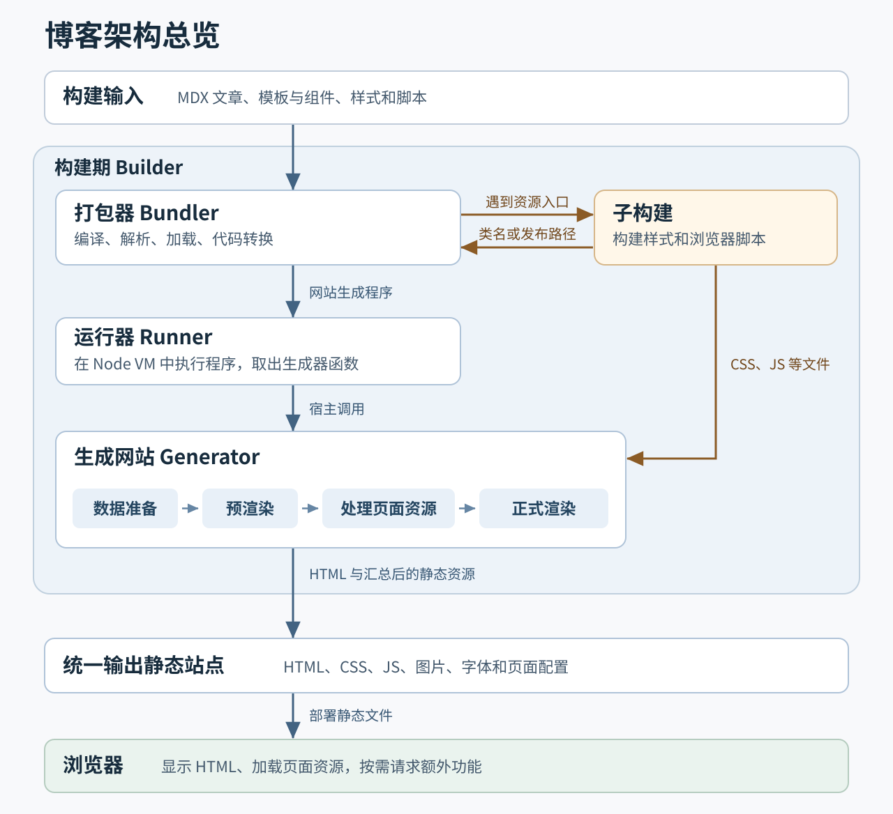
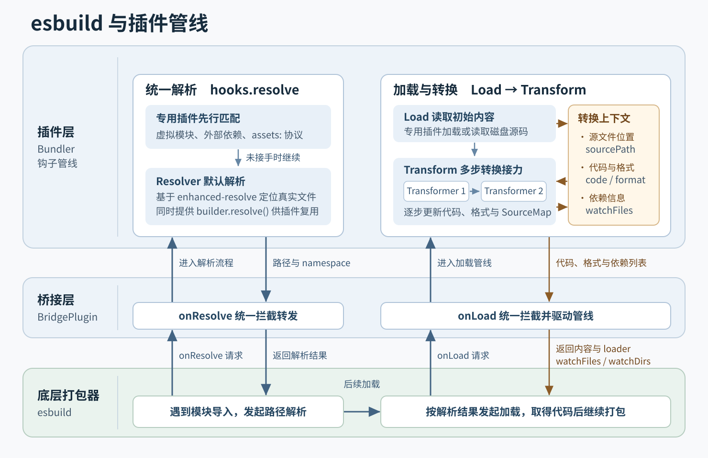
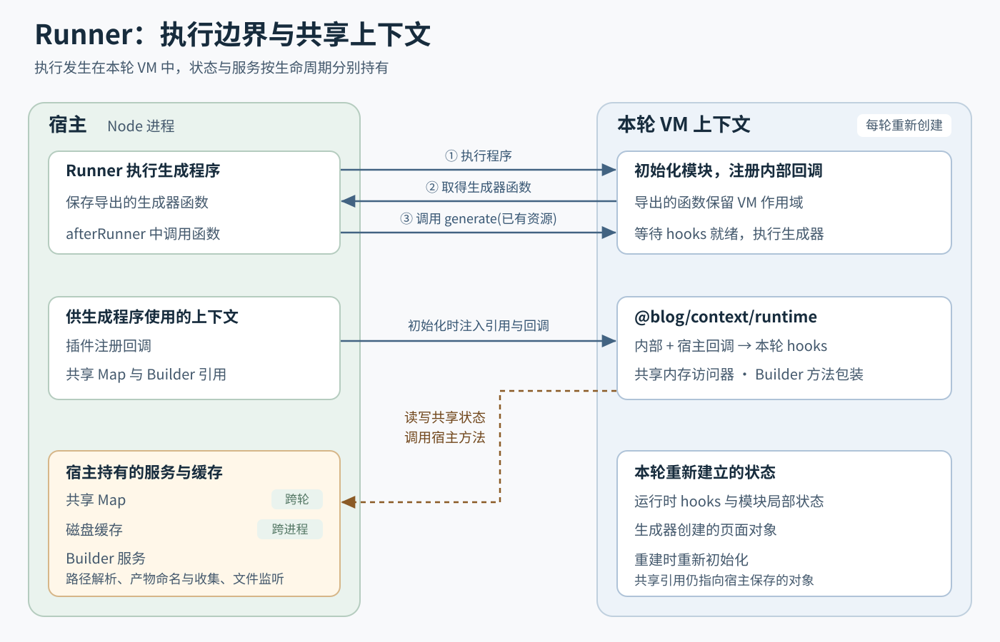
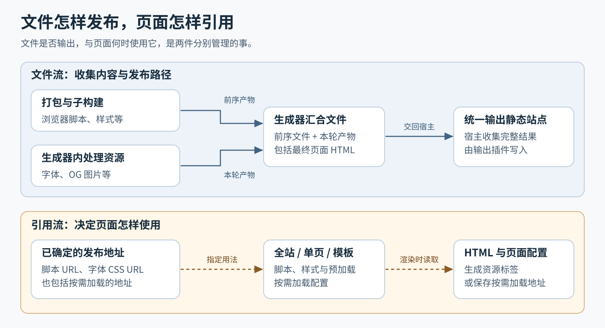
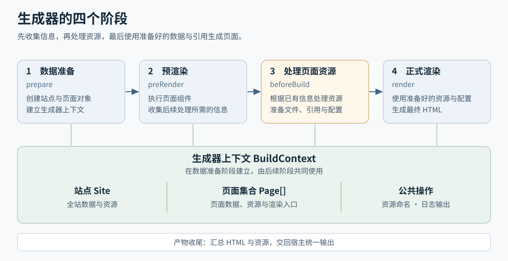
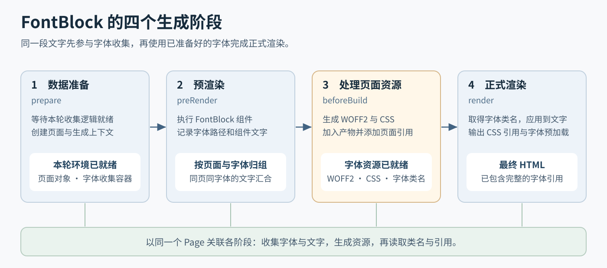
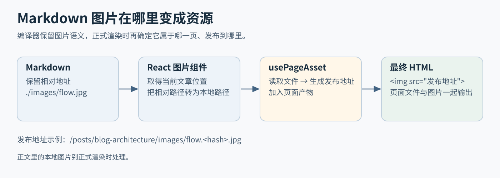
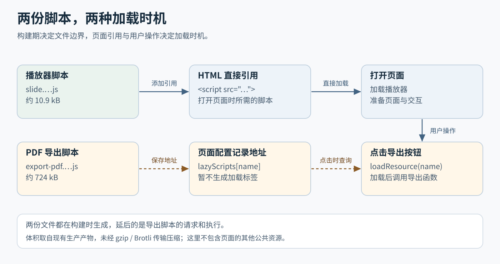

import { ArticleIntro, DefinitionList, Definition } from '@blog/mdx-typo';

<ArticleIntro label="开始之前">
  {props.post.description}
</ArticleIntro>

# 上个版本留下的两个问题

在[《博客架构介绍》](../blog-architecture/index.md)中，博客已经跑通了基本的静态生成流程，文章在构建期通过 React 渲染成 HTML，模板、样式、脚本全部用 TypeScript 编写，文章则使用技术上比较亲近的 MDX 语法。这样的话它们彼此之间可以直接共享变量与样式类名。这套模板与组件的基础设计本文不再重复展开，这里先从上一版结尾留下的两个问题说起。

第一个问题出在文章的图片处理上。为了把普通 Markdown 图片纳入资源处理流程，编译器要专门改写图片节点的解析流程。第二个问题是代码分割的边界需要手工维护，基础布局、文章模板和外部组件的脚本都能分别打包拆分，但哪些代码归入哪份产物，完全依赖人工维护`.script.ts`入口之间的引用关系。
起初我以为只需要顺着上一版的思路，分别修补图片转换和脚本分包这两个局部环节就好了。但随着后续逐步加入[模块热更新](../blog-hmr-update/)、按需加载、OG 分享图生成以及字体子集化等功能，我发现单靠局部修补已经行不通了。

# 术语约定

<DefinitionList>
  <Definition term="构建器" alias="Builder">
    整轮构建的宿主与顶层调度器，负责维护插件生命周期，协调代码打包、生成程序执行与最终产物输出。遇到样式或浏览器脚本入口时，可派生出复用同一套机制的**子构建**。
  </Definition>
  <Definition term="打包器" alias="Bundler">
    基于 esbuild 封装的编译模块，在底层打包能力之上统一接管模块解析、加载与多步代码转换。主构建用它编译出“网站生成程序”，子构建则用它打包浏览器端的静态资源。
  </Definition>
  <Definition term="运行器" alias="Runner">
    负责创建独立的 Node VM 执行上下文，向内注入宿主的构建能力与钩子回调，执行打包好的网站生成程序并取出导出的生成器函数。
  </Definition>
  <Definition term="生成器" alias="Generator">
    实际生成网站的程序，管理生成过程中的流程、数据与资源，按阶段完成两遍 React 渲染，并将页面资源与前序构建产物汇总。
  </Definition>
  <Definition term="构建期运行时">
    网站生成程序在 Node VM 中执行时所处的环境，负责承接宿主的生命周期调用、维护页面渲染上下文，并通过受限接口使用宿主能力。
  </Definition>
  <Definition term="浏览器运行时">
    最终随静态页面一起发布、交付给读者浏览器执行的脚本与页面配置，负责页面交互、按需加载额外功能以及开发期的模块热更新。
  </Definition>
</DefinitionList>

# 构建器怎样组织插件

上一版用 [esbuild 插件](https://github.com/xiaoboost/blog/tree/02864a4b/packages/tools/builder/src/bundler/plugins)处理文章、样式、脚本和外部依赖隔离。每个插件都在自己的`setup`函数里注册`onResolve`和`onLoad`，靠各自的正则表达式、自定义后缀和`namespace`来拦截请求。虚拟模块和特殊导入多起来后，各插件的规则就越来越难协调。

第一个难题是路径解析与上下文传递规则散落在各个插件内部。那会儿没有统一整理模块信息的传递方式，插件之间常常靠拼接路径字符串来传递数据和分割作用域。比如上一版用于隔离外部依赖的`LocalPackageLoader`，为了在`onLoad`阶段知道某个第三方包是被哪个源文件引用的，只能把导入方路径和包名硬拼进虚拟路径里，加载时再用正则拆解还原：

```ts
// 上一版 loader-local-package.ts：靠拼接路径字符串传递导入方位置与模块名
build.onResolve({ filter: /.*/ }, async (args) => {
  if (!(await isExternal(args.path))) return null;
  return {
    path: `${normalize(args.importer)}_${args.path}_local-module`,
    namespace: 'local-package',
  };
});

build.onLoad({ filter: /\_local-module$/, namespace: 'local-package' }, (args) => {
  const [file, moduleName] = parsePathFromModulePath(args.path);
  // 再拼出 `${file}_require` 虚拟路径触发下一轮解析……
});
```

第二个难题来自 [esbuild 的`onLoad`加载规则](https://esbuild.github.io/plugins/#on-load)：只要某一个`onLoad`回调返回了模块内容，当前模块的加载就会立刻结束，后续插件不再介入。这意味着同一份源码很难在多个插件之间“接力”转换。上一版的文章插件`PostLoader`为了先把 Markdown 前置信息拆出来、再把正文交给 MDX 编译器，只能先在`.mdx`文件的`onLoad`里把正文存进插件私有的`Map`，再返回一段拼上假后缀`.mdx-js`的二次导入代码，绕一圈触发第二个`onLoad`：

```ts
// 上一版 loader-post：为了拆成两步处理，只能伪造 .mdx-js 后缀再发起一次导入
build.onLoad({ filter: /\.mdx?$/ }, async (args) => {
  const { content, ...post } = await getPostData(args.path);
  const mdxPath = normalize(`${args.path}.mdx-js`);
  mdxContents.set(mdxPath, content);

  return {
    loader: 'js',
    contents: `import Component from '${mdxPath}';\nexport default { Component, ... };`,
  };
});
```

当后续还需要对编译后的代码统一替换文件位置常量（如`__dirname`、`import.meta.url`）、串联`SourceMap`或添加监听依赖时，靠伪造后缀和私有`Map`变得非常难以维护，到处都是散布在各处的私有规则，极大地破坏了代码的内聚性。

回头再看开头提到的图片处理、代码分割，连同这里的插件接力以及后续加入的 OG 图、字体子集化等需求，我才看出来它们其实都指向同一个目标：如何更好地管理构建资源，以及梳理清楚资源之间的引用关系。同一份源码在编译期往往需要经过多步转换接力；不同资源的生成时机也拉开了跨度，有的在打包阶段就能确定，有的却必须等到组件渲染、收集完页面信息后才能生成，最后还要按全站或单页归属到对应的页面上。

看清了这个共同目标，解法也就明确了：与其在各个加载器里继续打补丁，不如重新组织整套构建流程，把插件调度、子构建、运行器与页面资源模型纳入统一的生命周期。这就是现在的*博客构建器 5.0 版本*！

## 架构总览



主构建先用打包器把模板、组件和文章数据打包成一份网站生成程序。`Runner`在 Node VM 中执行这份程序，取出导出的生成器函数。宿主随后调用这个函数生成页面。打包和页面生成阶段产出的文件最终由宿主统一输出，组成完整的静态站点。

新架构参考了 [Webpack 的插件接口](https://webpack.js.org/api/plugins/)，用`tapable`管理生命周期。最外层的 [`Builder`](https://github.com/xiaoboost/blog/blob/db5d48930665f2bc3c8a3b66ddcf150f96e74476/packages/builder/core/src/builder/builder.ts) 负责调度整轮构建。每个插件通过统一的`apply(builder)`方法注册回调，可以参与打包时的模块解析与转换，也可以在页面生成、产物处理或输出阶段介入运行。

## 统一解析、加载与转换管线

在打包阶段，`Bundler`只向 esbuild 注册一个内部的 [桥接插件`BridgePlugin`](https://github.com/xiaoboost/blog/blob/b11c1e62358c26011aaaa0921c3f9e1fad5584b2/packages/builder/core/src/bundler/bridge.ts)，用`filter: /.*/`接管所有的`onResolve`和`onLoad`请求，再转发给`Bundler`自己的钩子管线：



路径解析由`bundler.hooks.resolve`钩子统一负责。每当遇到一次模块导入，排在前面的插件先判断是不是自己认识的特别路径格式，例如虚拟模块或需要隔离的外部依赖，如果是的那么这个插件就会拦截掉这个请求，由它自己处理。如果专用插件都没有接手，最后就交给挂载在末尾的 `Resolver`插件兜底，基于`enhanced-resolve`按当前构建的目标环境（Node 或浏览器）解析出真实文件路径。同时，这项解析能力也挂载为`builder.resolve()`供所有插件调用，专用插件在自定义规则下仍然需要查找磁盘文件时，直接调用统一接口即可，不必再各自引入查找工具。
模块加载与代码转换则通过桥接插件在`onLoad`回调内部拆出的 [`Load → Transform`管线](https://github.com/xiaoboost/blog/blob/b11c1e62358c26011aaaa0921c3f9e1fad5584b2/packages/builder/core/src/bundler/pipeline.ts)完成，用两步钩子实现类似 [Webpack Loader 链式流水线](https://webpack.js.org/concepts/loaders/)：

- *加载阶段 load*：找到唯一负责读取初始内容的处理器。虚拟模块由对应插件返回初始文本；常规磁盘文件则读取源码，并在模块信息中记录真实的源文件路径`sourcePath`与初始格式。
- *转换阶段 transform*：让多个转换器依次接力形成流水线。前一步产出的代码、当前格式和 SourceMap 封装在统一的转换状态中传给下一步；任何插件都可以通过上下文中的方法新增依赖文件、更新格式定义或串联代码映射，这些变更都会在管线结束时汇总给 esbuild 与`Builder`。

以“读取 MDX，再把它编译成 JSX”为例，在加入 Transformer 调度之前，已经有了`MdxLoader`，当时读取文件和编译 MDX 都只能在同一个`load`回调里完成，最后一次性交出 JSX。

```ts
// 改造前：load 同时负责读取文件与编译 MDX
bundler.hooks.load.tapPromise('mdx-loader', async (args) => {
  if (args.namespace !== 'mdx-loader') return;

  const source = await readFile(args.path, 'utf-8'); /*** hl ***/
  let code = await compileMdx(source, args.path, isDev); /*** hl ***/

  // 只能在 MDXLoader 内部做替换 __dirname 等全局常量的行为
  code = replaceIdentifier(code, '__dirname', JSON.stringify(dirname(args.path))); /*** hl ***/

  return {
    contents: code,
    loader: 'jsx',
    resolveDir: dirname(args.path),
  };
});
```

这个回调返回的内容会直接交给 esbuild。如果还想在编译后替换代码里的`__dirname`，就需要在这里*显式安排下一步处理，或者另外建立中转规则*。再注册一个`load`回调，并不能让它接收到这里已经编译好的 JSX，后续步骤怎样接上仍要由具体插件自己安排。
改造后，`load`只交出原始内容，说明它来自哪个文件、目前是什么格式；MDX 编译移到`transform`里，接收上一步的状态并交出自己的转换结果。

```ts
// 改造后：load 只负责读取，返回的内容仍然是 MDX
bundler.hooks.load.tapPromise('mdx-loader', async (args) => {
  if (args.namespace !== 'mdx-loader') return;

  return {
    contents: await readFile(args.path, 'utf-8'), /*** hl ***/
    source: { sourcePath: args.path, format: 'mdx' },
    resolveDir: dirname(args.path),
  };
});

// MDX 编译作为独立的一步转换接入管线
bundler.hooks.transform.tapPromise(
  { name: 'mdx-loader', stage: -100 },
  async (input, ctx) => {
    if (
      input.module.id.namespace !== 'mdx-loader'
      || input.format !== 'mdx'
      || !input.module.sourcePath
    ) return input;

    const code = await compileMdx(input.code, input.module.sourcePath, isDev); /*** hl ***/
    return ctx.update(input, { code, format: 'jsx', map: null });
  },
);

// SourceLocation 插件伪代码：在 MDX 编译后继续处理位置常量
bundler.hooks.transform.tap(
  { name: 'source-location', stage: -50 },
  (input, ctx) => {
    const sourcePath = input.module.sourcePath;
    if (!sourcePath || input.format !== 'jsx') return input;

    // 把 __dirname 换成原稿所在目录的字符串字面量
    const code = replaceIdentifier(input.code, '__dirname', JSON.stringify(dirname(sourcePath))); /*** hl ***/
    return ctx.update(input, { code });
  },
);
```

现在，编译出的 JSX 会交回转换管线，原稿位置继续保存在`module.sourcePath`中。后来加入的`SourceLocation`插件只需要把自己的转换回调注册在后面，就能接着处理这份 JSX，根据原稿位置替换`__dirname`等常量。MDX 插件只负责完成自己的转换，后续步骤的顺序和状态传递由管线管理。图中的两个 Transformer，在这个例子里就分别对应 MDX 编译和位置常量替换。 

## 把不同的资源交给子构建

理顺了单次打包的插件管线后，还要处理不同资源的运行环境差异。生成页面的模板代码`.tsx`在 Node 中执行，交互脚本`.script.ts`要在浏览器里运行，而样式`.jss.ts`则是用 TypeScript 编写的样式声明，需要先在构建期执行才能提取出 CSS 文本和类名映射。上一版在遇到这些入口时，是在插件内部各自调用一次裸的`esbuild.build()`，再分别维护文件监听列表与产物哈希重命名。现在有了统一的`Builder`，这些分支构建便收敛成了由父构建派生的*子构建*，直接复用同一套插件装配、文件监听和产物收集机制。

当父构建在`transform`阶段遇到`.script.ts`或`.jss.ts`入口时，对应的加载器插件会按入口路径创建或从缓存中复用子`Builder`实例，等待子构建执行完毕后再继续当前模块的转换。其中，样式子构建负责打包并运行样式代码，提取出 CSS 与供模板使用的类名；脚本子构建则按浏览器环境配置，顺着`.script.ts`的导入关系生成对应的 JS、CSS 等静态文件。子构建过程中收集到的监听文件会自动向上同步给父构建，开发模式下只有相关依赖发生变动，对应的子构建才会重新运行。
子构建完成后，会向父构建[回传两部分结果](https://github.com/xiaoboost/blog/blob/b11c1e62/packages/builder/core/src/plugins/script-loader/index.ts#L48)：一部分是生成的 CSS、JS、字体等静态文件，在`afterBundler`阶段统一交由父构建收集；另一部分则是供模板使用的类名或发布地址，通过把当前入口模块转换为导出数据的代码，直接交回给导入它的模板。

以 404 页面组件为例，它的脚本入口、样式声明与页面模板是这样配合的：

```tsx
// 1. not-found.script.ts：浏览器脚本入口，汇总该视图所需的样式与交互脚本
import './index.jss';
import { assets } from '@blog/context/web';
export default assets;

// 2. not-found/index.tsx：运行在 Node 中的 React 页面模板
import styles from './index.jss';
import assets from './not-found.script';

export function NotFound() {
  return (
    <Document assets={assets} className={styles.classes.page}>
      {/* 页面结构 */}
    </Document>
  );
}
```

当主构建编译`NotFound`模板时，`./index.jss`和`./not-found.script`分别触发各自的子构建，而它们在主构建中最终转换出的模块内容，则变成了纯粹的数据导出：

```js
// 主构建中 ./index.jss 的转换结果：向模板提供类名映射
export default {
  classes: { page: 'page-0-2-1', masthead: 'masthead-0-2-2' /* ... */ },
};

// 主构建中 ./not-found.script 的转换结果：向模板提供子构建产出的文件发布地址
export default [
  "/styles/not-found.a1b2c3.css",
  "/scripts/not-found.d4e5f6.js",
];
```

而在`not-found.script.ts`触发的脚本子构建内部，`./index.jss`在导出类名的同时还会注入一行对生成 CSS 的导入，让样式顺着浏览器打包流程被提取为独立的`.css`文件。通过这层拆分，模板代码可以在编译期直接引用类名和资源发布地址，同时让生成页面的 Node 代码与浏览器脚本各自保持独立的运行环境。至于这些已经生成好的文件最终怎样归属到具体页面并写入 HTML，我们留到后文“生成器怎样管理页面和资源”再展开。

# Runner 怎样执行生成程序

打包完成后，[`Runner`](https://github.com/xiaoboost/blog/blob/b11c1e62358c26011aaaa0921c3f9e1fad5584b2/packages/builder/core/src/runner/runner.ts) 接手生成程序的加载。运行出错时，它会用 SourceMap 把报错堆栈还原到源码位置。

关于为什么要把外部依赖从这份生成程序里剥离出来，[上一版的「Monorepo 依赖隔离」](../blog-architecture/index.md#Monorepo%20依赖隔离)已经详细介绍过，这里只简单回顾一下，我们自己编写的模板、组件和文章由 esbuild 打包合并；而主构建引用的第三方依赖（如`react`、`katex`）则不打进产物，而是由`LocalPackageRequirer`插件转换成以源文件所在路径创建的`createRequire(importer)`调用，直接交由 Node 原生的模块系统按子包各自的目录结构去加载。这样既省去了重复打包十几兆第三方库的开销，也保留了 Monorepo 中各子包独立的依赖解析位置。
生成程序在 VM 中运行，宿主插件怎样参与页面生成？开发模式下，哪些状态要随 VM 重建，哪些可以留到下一轮？



## 加载生成程序与调用生成器

`runner.run()`先创建一个新的 Node VM 上下文，注入宿主上下文，再执行打包好的生成程序。模块初始化会加载模板和组件，并注册内部钩子回调。`Runner`把入口文件默认导出的生成器函数保存到`runner.output`。
随后，宿主侧的`AssetExtractor`插件在`afterRunner`阶段通过`runner.getOutput()`取出生成器函数，把打包和子构建收集的静态资源作为参数传进去，再调用它开始生成页面。

```ts
// 宿主插件 AssetExtractor：在 afterRunner 阶段取出生成器函数并传入已有的静态资源
builder.hooks.afterRunner.tapPromise('asset-extractor', async ({ runner }) => {
  const assets = builder.getAssets();
  const generate = runner.getOutput();
  const runnerAssets = await generate(assets);
  // 合并生成器返回的完整资源列表与运行期间通过 emitAsset 新增的资源……
});
```

宿主调用`generate(assets)`时，函数仍保留创建时的 VM 作用域。分开加载和调用，也让宿主插件能在页面生成前注册回调。

## 宿主插件怎样参与页面生成

生成器也用`tapable`维护页面生成的钩子，VM 内的模板和组件、宿主侧的插件都可以在这些钩子上注册回调。

- *VM 内的模板和 MDX 组件*在模块顶层通过`@blog/context/runtime`的`onInit`、`onBuild`等接口注册回调，用于收集字体字符、生成 OG 图或为 TypeScript 代码块安装类型。
- *宿主侧的插件*包括生成 RSS 的`SiteDiscovery`和生成离线缓存清单的`Precache`。它们在`builder.hooks.runner`阶段调用`runner.registerHook()`。`Runner`创建 VM 时，通过`initGlobalContext`把收集到的回调注入 VM 的全局对象。

`onInit`用于进程内首次初始化，`onBuild`用于每轮构建。模块顶层代码执行完后，运行时在下一个宏任务中执行本轮的初始化回调和宿主回调，由这些回调向同一个`hooks`实例注册后续处理。生成器等`waitReady`就绪后再开始生成页面。

```ts
// 1. 宿主侧插件：通过 runner.registerHook 跨入生成期生命周期
builder.hooks.runner.tap('site-discovery', (runner) => {
  runner.registerHook(({ hooks }) => {
    hooks.beforeBuild.tap('site-discovery', ({ site, pages }) => {
      site.addAsset({ path: '/rss.xml', content: Buffer.from(createRss(site, pages)) });
    });
  });
});

// 2. VM 内模块在顶层通过 onBuild 注册同阶段的钩子
import { onBuild } from '@blog/context/runtime';

onBuild(({ hooks }) => {
  hooks.beforeBuild.tapPromise('layout:fonts', async ({ site }) => {
    // 处理全站字体子集……
  });
});

// 3. 生成器入口 main.ts：等待内外钩子统一挂载完毕后，再依次推进生成阶段
const main: RunnerCb = async (assets) => {
  await waitReady;
  await callHook('beforeStart');
  // 创建 Site 与 Page、执行预渲染、触发 beforeBuild、正式渲染并汇总资源……
};
```

## 通过上下文共享状态与宿主能力

在开发模式下，每次修改源码或文章都会触发新一轮构建，`Runner`也会随之创建全新的 VM 上下文并重新执行生成程序。如果所有状态都跟着 VM 一起销毁重建，像图片裁剪、字体读取、TypeScript 语言服务这类耗时操作就会在每次热更新时重复执行；反过来，如果不加区分地把状态都留在外层，上一轮残留的页面对象或钩子回调又会污染新一轮构建。
上一版其实已经做过从外层向运行环境注入缓存对象的尝试，但那时是直接读写裸的全局变量，哪些数据该留、哪些该清并没有明确的边界。现在，`@blog/context`把共享状态与宿主能力统一组织成运行上下文：宿主在启动 VM 时通过`initGlobalContext`注入共享内存、构建器引用和钩子回调，生成程序则从`@blog/context/runtime`导入相应的访问接口。两边仍然处于同一个 Node 进程中，传递的是对象与函数引用。

从状态的归属上来看，我按生命周期把它们划成了三类：

1. *随每轮 VM 重建的运行状态*：生成程序内的模块局部变量、本轮的运行时`hooks`实例，以及生成器创建的各个数据模型，每次都在新的 VM 上下文中从零创建。本轮的钩子表和页面集合也会随之重新建立。
2. *跨轮次复用的进程内共享内存*：宿主侧在`@blog/context`中维护了一个常驻进程的`Memory` Map，每轮注入的都是同一个对象。VM 内的代码通过`getAccessor`或`getReference`按命名键访问这块共享内存，用来复用 OG 分享图的裁剪结果、字体文件的内存 Buffer 等数据。
3. *跨进程持久化的落盘缓存*：对于需要跨构建进程复用的数据，则交由宿主提供的磁盘缓存接口管理，落盘到项目的缓存目录中，与进程内共享内存各司其职。

模板和组件通过`@blog/context/runtime`导出的`Builder`对象使用宿主的构建服务。这个对象封装了生成期需要的方法和配置。

- 用宿主的模块解析规则查找字体和其他本地资源。
- 按组件名称申请磁盘缓存空间，保存需要跨进程复用的数据。
- 按宿主的哈希命名规则生成文件的发布路径，也可以向宿主的产物列表添加静态文件。
- 把生成期间读取的文件加入监听列表，让它们的变化也能触发重建。

有了这套上下文，生成器就能在每轮重新建立的运行状态中，继续使用宿主提供的插件、缓存和构建服务。接下来再进入生成器内部，看看页面和资源是怎样组织起来的。

# 生成器怎样管理页面和资源

前面讲的打包器和运行器，最终都是在为这一步做准备：把文章数据和 React 组件变成可以直接发布的静态页面。
从最初开始，我就希望尽量把工作留在构建期。React 负责生成 HTML，浏览器只接收页面真正需要的交互脚本。样式、字体和图片也各自作为独立文件发布。这样我可以自己决定哪些资源全站共享，哪些只属于某篇文章，以及它们什么时候加载。模板和组件在上一版中就已经存在，后来增加的`Site`和`Page`让它们可以共享页面数据，并管理需要发布的文件和页面引用。

## 文件的产生与页面的使用

管理资源时，需要考虑产物从哪里来，以及页面怎样使用它。子构建生成的脚本可以只供某一页使用，生成器产出的字体也可以由全站共用。
为此我设计了[生成器的资源类](https://github.com/xiaoboost/blog/blob/b11c1e62358c26011aaaa0921c3f9e1fad5584b2/packages/builder/generator/src/model/resource-set.ts)。`addAsset`把文件加入产物列表。`addStyle`和`addScript`给页面添加样式和脚本引用，`addPreload`指定要提前加载的资源。

```ts
// 伪代码：CSS 内容和发布路径已经由资源处理步骤确定
const file = { path: cssPath, content: cssContent };

// 把这个文件交给最终输出流程
page.addAsset(file);

// 让当前页面在 head 中以 CSS 的方式引用它
page.addStyle({ href: file.path });
```

页面可以直接引用子构建产物的发布地址，按需加载的脚本地址也可以写入页面配置。
`Site`和`Page`都继承了这套资源接口。`Site`保存站点信息和全站资源。`Page`保存当前页的路径、数据、渲染函数和单页资源。生成器插件可以一次处理整批页面，React 组件则通过上下文取得当前的`Site`和`Page`。渲染时，`Document`合并来自站点、当前页和模板的资源引用，输出对应的`script`、`link`等标签。



最后，生成器把页面 HTML 和期间新增的文件汇入 Builder 的产物管线中，执行`processAssets`和`afterBuild`后交回宿主统一输出。

## 为什么要渲染两遍

页面生成分成四个阶段，数据准备时创建的`Site`和`Page`对象会在后续阶段共用。



一篇文章可能在几处用`FontBlock`显示同一份字体。如果每个块按自己的文字生成字体子集，一页就可能多出几份 WOFF2 和对应的 CSS 规则，重复出现的字也可能被打包多次。所以我把同一页里使用同一份字体的文字合在一起，只生成一份字体子集。
单个`FontBlock`只知道自己显示的文字。生成器要等正文组件都执行完，才能收齐这一页所有`FontBlock`用到的字符。字体子集化是异步的，当前用的`renderToString`会同步返回整页 HTML，无法在渲染中途等它完成。模板生成页面头部时就需要字体 CSS 的发布地址，所以生成器先渲染一遍收集字符，再在`beforeBuild`中等待字体和 CSS 生成，最后渲染第二遍，把准备好的引用写进 HTML。
Slide 也在预渲染时收集正文组件声明的动画，用来生成页面引用的配置脚本。文章标题和目录已经包含在页面数据里，可以直接拿来收集字体字符。正文里的本地图片则留到正式渲染时处理。

## FontBlock 的字体资源流程

字体子集化是推动这套机制成形的一次重要改造。这里以文章里的`FontBlock`为例：作者指定一份字体文件，组件显示的这段文字决定需要保留哪些字符。

```jsx
import { FontBlock } from '@blog/mdx-font-block';

<FontBlock src="./fonts/custom.ttf">
  这段文字使用指定的字体。
</FontBlock>
```



[`FontBlock`的构建逻辑](https://github.com/xiaoboost/blog/blob/db5d48930665f2bc3c8a3b66ddcf150f96e74476/packages/components/font-block/src/font.ts)通过`onBuildWithRender`为本轮建立收集状态，并注册资源处理回调。生成器在数据准备阶段等待这些初始化逻辑就绪，再创建`Page`等对象，准备执行文章中的组件。此时还没有构建这段文字需要的字体。

预渲染时，`FontBlock`从传入的组件`Props`里提取文字，解析字体文件的路径，再按当前页面和解析后的路径归组保存。
到了`beforeBuild`，组件的构建回调读取原始字体，把收集到的文字放进当前`Page`的字体集合。随后，`buildFonts()`生成 WOFF2 和 CSS，把文件加入本页的产物列表，并添加样式引用和字体预加载。
正式渲染时，同一个`FontBlock`组件再次执行，取回已经准备好的字体类名并应用到文字上。`Document`则从页面资源记录中输出 CSS 引用与字体预加载。

后来加入的 OG 分享图处理也沿用了这套机制。封面来源已经在页面配置中确定，生成器可以直接在`beforeBuild`中裁剪、压缩原图，再把默认图和文章专用图分别加入`Site`和对应`Page`的产物列表。正式渲染时，页面把发布地址写入`og:image`。

# 新架构解决问题了吗？

到这里我已经介绍完了新架构的构成，终于可以回头看看上一版留下的两个问题了。新的插件管线和页面模型提供了不同阶段之间的连接，问题到底有没有解决呢？

## 图片资源引用

先回到上一版的做法。作者写的是普通 Markdown 图片，构建器却需要把它改写成资源导入与 JSX，再另外导出资源列表：

```md

```

```tsx
// 上一版的处理方式，省略无关内容
import Image from './images/flow.jpg';


export function getPostAssetNames() {
  return [Image];
}
```

之所以走这条路，一部分原因是我当时希望在 Markdown 图片地址里直接使用变量。但``中的地址并不会像 JSX 属性那样求值，后来升级到 MDX 3，这个语法上的区别也仍然存在。需要 JavaScript 表达式时，应当使用``这样的 JSX 写法，而普通 Markdown 图片的地址仍然是文本。
另一个原因是我希望图片也能在构建时压缩、转换格式，并根据处理后的内容加上 hash。上一版里，我先把图片改写为`import`，让构建器处理文件，再把新的发布地址交给组件。

页面生成同样发生在构建期。[当前的图片组件](https://github.com/xiaoboost/blog/blob/db5d48930665f2bc3c8a3b66ddcf150f96e74476/packages/templates/post/src/post/image/index.tsx)保留 Markdown 传来的相对地址，等到正式渲染时再根据文章位置找到本地文件。

```tsx
// 伪代码：只展示普通文章中的本地图片
function PostImage({ src, alt }) {
  const { page, isPreBuild } = useRenderContext();
  if (isPreBuild) return null;

  const source = resolve(
    dirname(page.data.post.data.filePath),
    decodeURIComponent(src),
  );
  const asset = usePageAsset(source);

  return ;
}
```

`usePageAsset`读取文件，按宿主的命名规则生成发布路径，再把文件加入当前页的产物列表。以`./images/flow.jpg`为例，最终的 HTML 会使用类似`/posts/blog-architecture/images/flow.<hash>.jpg`的地址。



回头看，上一版处理图片之所以别扭，是因为我把图片发布也绑在了语法转换上。Parser 负责把公式和开启了语言服务的代码块转成对应组件，并根据组件的导入收集它们声明的资源。

## 代码分割

代码分割的回答就没有这么漂亮了。子构建已经能按入口打包，页面也能选用各自需要的脚本和样式。哪些模块会进同一个包，仍然由入口及其导入关系决定。
比如 Slide 的播放器打开页面时就要用，PDF 导出功能只在读者点击按钮时才用得上。现有产物里，播放器脚本约为 10.9 kB，PDF 导出脚本约为 724 kB。如果把它们打进同一个包，读者一打开 Slide 就得加载这份大得多的导出代码。
现在，Slide 模板分别引入播放器和 PDF 导出的入口，两份脚本各自由子构建打包。

```ts
// 简化后的 Slide 模板声明
import playerAssets from './slide.script';
import exportAssets from './export/export-pdf.script';

// 在导出资源时声明异步加载的部分
export const utils = defineUtils(playerAssets, {
  browserConfig: {
    lazyScripts: {
      'slide.export': exportAssets,
    },
  },
});
```

播放器脚本由 HTML 直接引用。导出脚本的地址写入页面配置的`lazyScripts`，这份配置作为独立脚本随页面异步加载。读者点击导出按钮时，播放器再加载导出资源并调用导出函数。

```ts
// 浏览器端通过相同的 key 加载这个异步资源
const exporter = await loadResource('slide.export');
await exporter.exportPdf(options);
```

[`loadResource`](https://github.com/xiaoboost/blog/blob/db5d48930665f2bc3c8a3b66ddcf150f96e74476/packages/builder/context/src/web/load-resource.ts)先等待页面配置，找到名字对应的一组地址，加载其中的 CSS，再按顺序加载脚本。同一个 URL 的加载任务会复用，加载失败时也会清除对应记录，让下一次操作可以重试。



### 为什么继续使用 IIFE

前面的异步加载，其实可以直接用浏览器原生的 ESM 来表达。模块自带独立作用域，可以通过`export`提供接口，再通过`import()`按需加载并取得导出值，甚至 esbuild 是原生支持 [ESM 的自动代码分割](https://esbuild.github.io/api/#splitting)。无论是模块之间的依赖关系，还是加载后怎样取得接口，ESM 都已经有现成的机制。

之所以没有采用这个方案，主要还是迁移成本太高。现有的脚本加载、资源交付和 HMR 插件，都是围绕独立的普通脚本建立的。比如，HMR 对普通脚本的更新，是先按脚本路径卸载旧模块，再插入一个普通`script`标签执行新代码。换成 ESM 后，这套模块识别、加载和更新约定也要一起调整，相关插件需要配合重构。
子构建也不只是把`format`改成`esm`就行。如果要用上自动分割，就需要管理入口和它引用的一组文件。现在产物可以在子构建结束后分别加 hash、重命名、调整发布路径；有了文件之间的`import`，这些改名就必须同步维护引用关系。要进一步提取不同入口的公共依赖，还需要重新组织子构建，让相关入口进入同一张构建依赖图。为了眼前的按需加载需求，把这些流程一起重构，现阶段的成本实在太高了。

所以我选择了现在的折衷方案，脚本子构建继续输出 IIFE，保留现有的构建与热更新方式，只是把需要延迟加载的功能拆成独立入口，通过前面的页面配置和加载器连接起来。

导出功能还需要把一个函数交回调用方，于是增加了一个很小的[脚本导出接口](https://github.com/xiaoboost/blog/blob/db5d48930665f2bc3c8a3b66ddcf150f96e74476/packages/builder/context/src/web/script-export.ts)，脚本在同步执行时，把导出值挂到`document.currentScript`对应的标签对象上；加载器在该标签的`load`事件中读取它。

```ts
// 被异步加载的导出脚本
import { setScriptExports } from '@blog/context/web';
import { exportPdf } from './pdf';

// 同步执行时，将能力交给加载自己的 script 标签
setScriptExports({ exportPdf });
```

上一版的代码分割问题，这一版算是解决了一半。页面有了统一的按需加载接口，分包边界还需要手动划分。

# 新架构的优势

讲完这些接口与流程，再来看几个后来加入的功能，我个人感觉还挺不错的。对我来说，新架构让我能很方便的给整个构建流程添加更多的积木，更多的观察。

## 观察整个构建过程

以前要知道构建为什么慢，往往得在不同插件里分别埋计时。现在，插件都通过具名的生命周期钩子接入，调试插件 Interceptor 就可以统一拦截 Builder 与 Bundler 的钩子注册，在回调外面补上计时，统计每个插件在哪个阶段调用了多少次、用了多久。
各流程在阶段起止处计时。拦截器读取 Builder 提供的阶段耗时，包括代码打包、页面生成和资源输出，以及生成器内部的准备、预渲染、资源处理和正式渲染。和插件回调的统计放在一起，就能看清时间花在哪一步，这一步又有哪些插件参与。
我还把这个功能接入了 Github PR 中，比如这个 [#207](https://github.com/xiaoboost/blog/pull/207)，在 PR 的回复中可以看到机器人发的构建性能报告，这就式这个调试插件产出的内容。我可以很方便的观察构建性能的劣化情况。

## RSS 的简易接入

RSS 之类的接入就更简单了，它从外层 Builder 注册，通过 Runner 接入生成期的`beforeBuild`，读取已经准备好的站点与页面数据，生成 RSS、sitemap 和`robots.txt`。

```ts
// 伪代码：省略外层注册和 XML 序列化细节
hooks.beforeBuild.tap('site-discovery', ({ site, pages }) => {
  const path = normalizeUrl(site.publicPath, 'rss.xml');
  const url = new URL(path, site.origin).href;

  // 将 RSS 文件加入产出文件
  site.addAsset({
    path,
    content: Buffer.from(createRss(site, pages, url)),
  });
  // 将 RSS 标签加入 HTML 头部引用
  site.addLink({
    rel: 'alternate',
    type: 'application/rss+xml',
    title: site.title,
    href: url,
  });
});
```

`addAsset`让订阅文件进入统一输出，`addLink`让页面外壳输出 RSS 的发现链接。如此简单。

# 还有哪些不完善

这次架构变更，我感觉还是比较完善的，今后这个博客的架构应该不会再有太大的变化了，但是还是有些小地方我觉得还是未竟全功。

首先是多个浏览器入口之间的公共依赖。各个子构建分别打包，同一个依赖被多个入口引入时，可能出现在几份产物里。这些重复打包的问题，在通常的构建器里都是自动处理的，而在这里只能由我手动拆分处理。
其次是子构建的缓存问题，现在`.script.ts`和`.jss.ts`子构建已经可以复用没有变化的结果，但是不同的子构建其实可能有相同的内容，比如一个`.jss.ts`入口，可能同时被某个模板和`.script.ts`引用，这两个也是不同的子构建，所以没有办法复用这里这个相同的`.jss.ts`的构建结果。
最后，现在已经把构建能力拆成了可插拔的插件，但核心插件之间的依赖与装载顺序仍然依赖约定。比如路径解析、资源命名、缓存等基础服务必须先就绪，某些插件也依赖特定的接入顺序；`AssetExtractor`为了合并执行期间新增的文件，还直接访问了 Builder 的内部产物列表。插件系统之后如何声明和构造自己的加载顺序和依赖关系，也是需要思考的问题。
