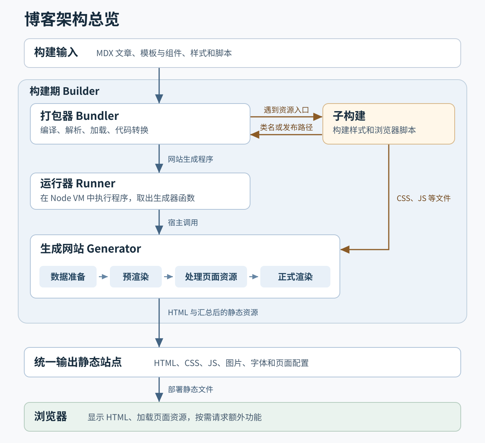
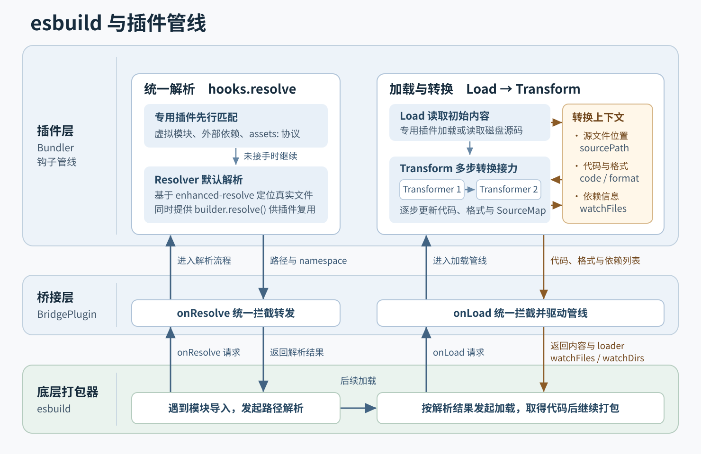
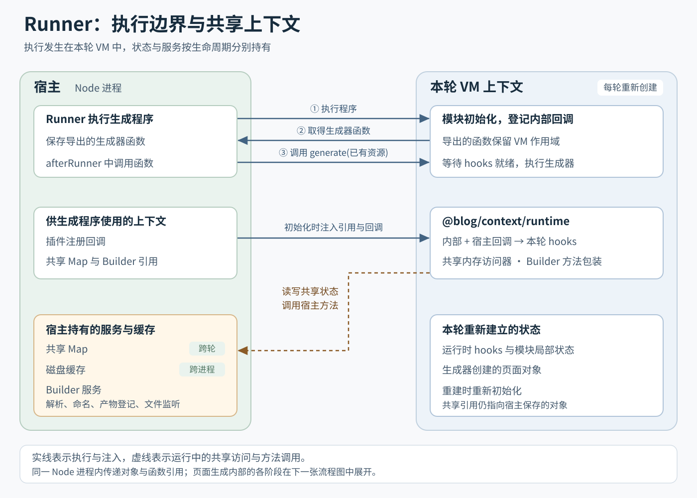
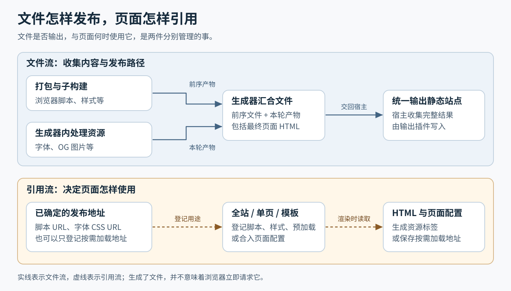
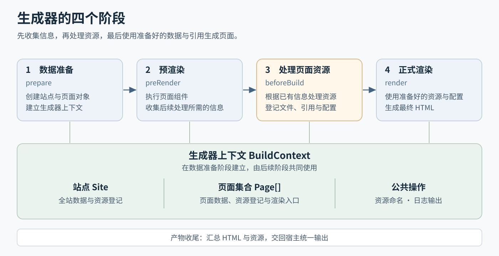
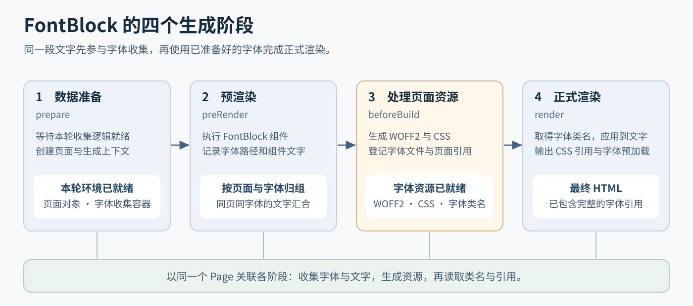
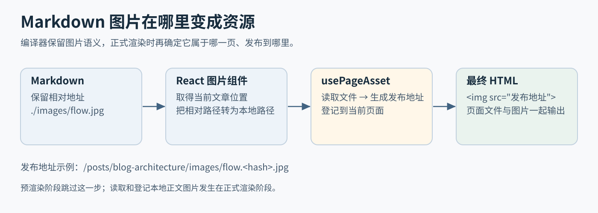
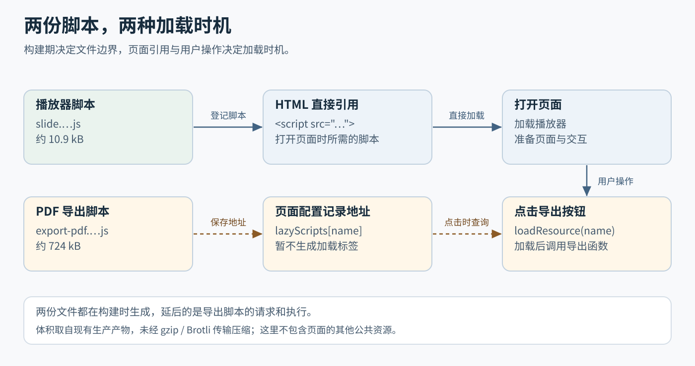

import { DefinitionList, Definition } from '@blog/mdx-typo';

# 上个版本留下的两个问题

在[《博客架构介绍》](../blog-architecture/index.md)中，博客已经跑通了基本的静态生成流程，文章在构建期通过 React 渲染成 HTML，模板、样式、脚本和 MDX 文章全部用 TypeScript 编写，彼此之间可以直接共享变量与样式类名。这套模板与组件的基础设计本文不再重复展开，这里先从上一版结尾留下的两个问题说起。

第一个问题是文章里的图片处理的很麻烦。普通 Markdown 图片可以正常使用，但构建器需要在编译阶段拦截语法树，找出图片节点，手动在模块顶部补上资源导入、把节点改写成 JSX，再在文件末尾附上导出资源列表的函数，才能把图片送进资源管线。这套专为图片维护的语法树改写逻辑实在是麻烦，甚至需要深入 MDX 编译器内部。
第二个问题是代码分割的边界需要手工维护，基础布局、文章模板和外部组件的脚本都能分别打包拆分，但哪些代码归入哪份产物，完全依赖人工维护`.script.ts`入口之间的引用关系。一旦想调整分包边界，或者让某些较重的功能延迟到读者主动使用时再加载，就得自己梳理整条引用链。

起初我以为只需要顺着上一版的思路，分别修补图片转换和脚本分包这两个局部环节就好了。但随着后续逐步加入[模块热更新](../blog-hmr-update/)、按需加载、OG 分享图生成以及字体子集化等功能，我发现单靠局部修补已经行不通了。

# 术语约定

<DefinitionList>
  <Definition term="构建器" alias="Builder">
    整轮构建的宿主与顶层调度器，负责维护插件生命周期，协调代码打包、生成程序执行与最终产物输出。遇到样式或浏览器脚本入口时，可派生出复用同一套机制的**子构建**。
  </Definition>
  <Definition term="打包器" alias="Bundler">
    基于 esbuild 封装的编译模块，在底层打包能力之上统一接管模块解析、加载与多步代码转换。主构建用它编译出“网站生成程序”，子构建则用它打包浏览器端的静态资源。
  </Definition>
  <Definition term="运行器" alias="Runner">
    负责创建独立的 Node VM 执行上下文，向内注入宿主的构建能力与钩子回调，执行打包好的网站生成程序并取出导出的生成器函数。
  </Definition>
  <Definition term="生成器" alias="Generator">
    实际生成网站的程序，管理生成过程中的流程、数据与资源，按阶段完成两遍 React 渲染，并将页面资源与前序构建产物汇总。
  </Definition>
  <Definition term="构建期运行时">
    网站生成程序在 Node VM 中执行时所处的环境，负责承接宿主的生命周期调用、维护页面渲染上下文，并通过受限接口使用宿主能力。
  </Definition>
  <Definition term="浏览器运行时">
    最终随静态页面一起发布、交付给读者浏览器执行的脚本与页面配置，负责页面交互、按需加载额外功能以及开发期的模块热更新。
  </Definition>
</DefinitionList>

# 构建器怎样组织插件

在上一版中，文章、样式、脚本和依赖隔离等等行为都是直接作为 [esbuild 插件](https://github.com/xiaoboost/blog/tree/02864a4b/packages/tools/builder/src/bundler/plugins)挂载的。每个插件都在自己的`setup`函数里注册`onResolve`和`onLoad`，靠各自的正则表达式、自定义后缀和`namespace`来拦截请求。随着构建里出现的虚拟模块和特殊导入越来越多，这种平铺直叙的写法很快暴露出两个维护上的难题。

第一个难题是路径解析与上下文传递规则散落在各个插件内部。那会儿没有统一整理模块信息的传递方式，插件之间常常靠拼接路径字符串来传递数据和分割作用域。比如上一版用于隔离外部依赖的`LocalPackageLoader`，为了在`onLoad`阶段知道某个第三方包是被哪个源文件引用的，只能把导入方路径和包名硬拼进虚拟路径里，加载时再用正则拆解还原：

```ts
// 上一版 loader-local-package.ts：靠拼接路径字符串传递导入方位置与模块名
build.onResolve({ filter: /.*/ }, async (args) => {
  if (!(await isExternal(args.path))) return null;
  return {
    path: `${normalize(args.importer)}_${args.path}_local-module`,
    namespace: 'local-package',
  };
});

build.onLoad({ filter: /\_local-module$/, namespace: 'local-package' }, (args) => {
  const [file, moduleName] = parsePathFromModulePath(args.path);
  // 再拼出 `${file}_require` 虚拟路径触发下一轮解析……
});
```

第二个难题来自 [esbuild 的`onLoad`加载规则](https://esbuild.github.io/plugins/#on-load)：只要某一个`onLoad`回调返回了模块内容，当前模块的加载就会立刻结束，后续插件不再介入。这意味着同一份源码很难在多个插件之间“接力”转换。上一版的文章插件`PostLoader`为了先把 Markdown 前置信息拆出来、再把正文交给 MDX 编译器，只能先在`.mdx`文件的`onLoad`里把正文存进插件私有的`Map`，再返回一段拼上假后缀`.mdx-js`的二次导入代码，绕一圈触发第二个`onLoad`：

```ts
// 上一版 loader-post：为了拆成两步处理，只能伪造 .mdx-js 后缀再发起一次导入
build.onLoad({ filter: /\.mdx?$/ }, async (args) => {
  const { content, ...post } = await getPostData(args.path);
  const mdxPath = normalize(`${args.path}.mdx-js`);
  mdxContents.set(mdxPath, content);

  return {
    loader: 'js',
    contents: `import Component from '${mdxPath}';\nexport default { Component, ... };`,
  };
});
```

当后续还需要对编译后的代码统一替换文件位置常量（如`__dirname`、`import.meta.url`）、串联`SourceMap`或添加监听依赖时，靠伪造后缀和私有`Map`变得非常难以维护，到处都是散布在各处的私有规则，极大地破坏了代码的内聚性。

回头再看开头提到的图片处理、代码分割，连同这里的插件接力以及后续加入的 OG 图、字体子集化等需求，我才看出来它们其实都指向同一个目标：如何更好地管理构建资源，以及梳理清楚资源之间的引用关系。同一份源码在编译期往往需要经过多步转换接力；不同资源的生成时机也拉开了跨度，有的在打包阶段就能确定，有的却必须等到组件渲染、收集完页面信息后才能生成，最后还要按全站或单页归属到对应的页面上。

看清了这个共同目标，解法也就明确了：与其在各个加载器里继续打补丁，不如重新组织整套构建流程，把插件调度、子构建、运行器与页面资源模型纳入统一的生命周期。这就是现在的*博客构建器 5.0 版本*！

## 架构总览



改造后的整体结构如上图。和常规前端项目直接打包出浏览器代码不同，主构建先由打包器编译出一份“网站生成程序”，交给运行器在独立的上下文中执行并取出生成器函数，再由外层宿主调用这个函数生成页面。构建期和生成期两个阶段产出的静态资源在此汇总合并，最后导出完整的静态站点。

为了组织这一整套流程，新架构在 API 层面参考了 [Webpack 的插件接口](https://webpack.js.org/api/plugins/)，引入`tapable`来管理生命周期。最外层的 [`Builder`](https://github.com/xiaoboost/blog/blob/2c07064c/packages/builder/core/src/builder/builder.ts) 并不直接参与处理具体文件，而是负责控制构建流程和协调插件调度。每个插件都实现统一的`apply(builder)`方法，在初始化时把回调挂载到对应的钩子上。
构建的主干流程其实和上一版保持一致，这次改造改变的是插件的接入层次。插件不再直接塞进 esbuild 的配置数组，也不必再关心底层的打包与 VM 执行细节，而是通过上层封装的桥接机制，接入到语义更明确、也更贴合博客构建场景的生命周期中。无论是编译期的模块解析与转换、运行期的页面生成，还是最后的产物处理与输出，插件都只需在自己关心的阶段挂载回调即可。

## 统一解析、加载与转换管线

在打包阶段，`Bundler`只向 esbuild 注册一个内部的 [桥接插件`BridgePlugin`](https://github.com/xiaoboost/blog/blob/b11c1e62358c26011aaaa0921c3f9e1fad5584b2/packages/builder/core/src/bundler/bridge.ts)，用`filter: /.*/`接管所有的`onResolve`和`onLoad`请求，再转发给`Bundler`自己的钩子管线：



路径解析由`bundler.hooks.resolve`钩子统一负责。每当遇到一次模块导入，排在前面的插件先判断是不是自己认识的特别路径格式，例如虚拟模块或需要隔离的外部依赖，如果是的那么这个插件就会拦截掉这个请求，由它自己处理。如果专用插件都没有接手，最后就交给挂载在末尾（`stage: 999`）的 [`Resolver`插件](https://github.com/xiaoboost/blog/blob/b11c1e62358c26011aaaa0921c3f9e1fad5584b2/packages/builder/core/src/plugins/resolver.ts)兜底，基于`enhanced-resolve`按当前构建的目标环境（Node 或浏览器）解析出真实文件路径。同时，这项解析能力也挂载为`builder.resolve()`供所有插件调用，专用插件在自定义规则下仍然需要查找磁盘文件时，直接调用统一接口即可，不必再各自引入查找工具。
模块加载与代码转换则通过桥接插件在`onLoad`回调内部拆出的 [`Load → Transform`管线](https://github.com/xiaoboost/blog/blob/b11c1e62358c26011aaaa0921c3f9e1fad5584b2/packages/builder/core/src/bundler/pipeline.ts)完成，用两步钩子实现类似 [Webpack Loader 链](https://webpack.js.org/concepts/loaders/)的流水线：

- *加载阶段 load*：采用`AsyncSeriesBailHook`找到唯一负责读取初始内容的处理器。虚拟模块由对应插件返回初始文本；常规磁盘文件则读取源码，并在模块信息中记录真实的源文件路径`sourcePath`与初始格式。
- *转换阶段 transform*：采用`AsyncSeriesWaterfallHook`让多个转换器依次接力形成流水线。前一步产出的代码、当前格式和 SourceMap 封装在统一的转换状态中传给下一步；任何插件都可以通过上下文中的方法新增依赖文件、更新格式定义或串联代码映射，这些变更都会在管线结束时汇总给 esbuild 与`Builder`。

以“读取 MDX，再把它编译成 JSX”为例，对比引入 Transformer 管线前后的同一个`MdxLoader`，会更容易看出变化。下面的代码省略了路径解析、缓存和插件初始化，并把`@blog/parser`里的`transform`函数记作`compileMdx`。
在加入 Transformer 调度之前，已经有了[`MdxLoader`](https://github.com/xiaoboost/blog/blob/a6c74e385fb906f2f98ba6bfa919994db2cce432/packages/builder/core/src/plugins/post-loader/mdx.ts)，当时读取文件和编译 MDX 都只能在同一个`load`回调里完成，最后一次性交出 JSX。

```ts
// 改造前：load 同时负责读取文件与编译 MDX
bundler.hooks.load.tapPromise('mdx-loader', async (args) => {
  if (args.namespace !== 'mdx-loader') return;

  const source = await readFile(args.path, 'utf-8');
  let code = await compileMdx(source, args.path, isDev);

  // 替换 __dirname 等全局常量 /*** hl ***/
  code = replaceIdentifier(code, '__dirname', JSON.stringify(dirname(args.path))); /*** hl ***/

  return {
    contents: code,
    loader: 'jsx',
    resolveDir: dirname(args.path),
  };
});
```

这个回调返回的内容会直接交给 esbuild。如果还想在编译后替换代码里的`__dirname`，就需要在这里*显式安排下一步处理，或者另外建立中转规则*。再注册一个`load`回调，并不能让它接收到这里已经编译好的 JSX，后续步骤怎样接上仍要由具体插件自己安排。
改造后，`load`只交出原始内容，说明它来自哪个文件、目前是什么格式；MDX 编译移到`transform`里，接收上一步的状态并交出自己的转换结果。

```ts
// 改造后：load 只负责读取，返回的内容仍然是 MDX
bundler.hooks.load.tapPromise('mdx-loader', async (args) => {
  if (args.namespace !== 'mdx-loader') return;

  return {
    contents: await readFile(args.path, 'utf-8'),
    source: { sourcePath: args.path, format: 'mdx' },
    resolveDir: dirname(args.path),
  };
});

// MDX 编译作为独立的一步转换接入管线
bundler.hooks.transform.tapPromise(
  { name: 'mdx-loader', stage: -100 },
  async (input, ctx) => {
    if (
      input.module.id.namespace !== 'mdx-loader'
      || input.format !== 'mdx'
      || !input.module.sourcePath
    ) return input;

    const code = await compileMdx(input.code, input.module.sourcePath, isDev);
    return ctx.update(input, { code, format: 'jsx', map: null });
  },
);

// SourceLocation 插件伪代码：在 MDX 编译后继续处理位置常量
bundler.hooks.transform.tap(
  { name: 'source-location', stage: -50 },
  (input, ctx) => {
    const sourcePath = input.module.sourcePath;
    if (!sourcePath || input.format !== 'jsx') return input;

    // 把 __dirname 换成原稿所在目录的字符串字面量
    const code = replaceIdentifier(input.code, '__dirname', JSON.stringify(dirname(sourcePath)));
    return ctx.update(input, { code });
  },
);
```

现在，编译出的 JSX 会交回转换管线，原稿位置继续保存在`module.sourcePath`中。后来加入的`SourceLocation`插件只需要把自己的转换回调注册在后面（`stage: -50`），就能接着处理这份 JSX，根据原稿位置替换`__dirname`等常量。MDX 插件只负责完成自己的转换，后续步骤的顺序和状态传递由管线管理。图中的两个 Transformer，在这个例子里就分别对应 MDX 编译和位置常量替换。 

## 把不同的资源交给子构建

理顺了单次打包的插件管线后，还要处理不同资源的运行环境差异。生成页面的模板代码`.tsx`在 Node 中执行，交互脚本`.script.ts`要在浏览器里运行，而样式`.jss.ts`则是用 TypeScript 编写的样式声明，需要先在构建期执行才能提取出 CSS 文本和类名映射。上一版在遇到这些入口时，是在插件内部各自调用一次裸的`esbuild.build()`，再分别维护文件监听列表与产物哈希重命名。现在有了统一的`Builder`，这些分支构建便收敛成了由父构建派生的**子构建**（`parent.createChild()`），直接复用同一套插件装配、依赖登记和产物收集机制。

当父构建在`transform`阶段遇到`.script.ts`或`.jss.ts`入口时，对应的加载器插件会按入口路径创建或从缓存中复用[子`Builder`实例](https://github.com/xiaoboost/blog/blob/b11c1e62/packages/builder/core/src/plugins/script-loader/builder/builder.ts#L10)，等待子构建执行完毕后再继续当前模块的转换。其中，样式子构建负责打包并运行样式代码，提取出 CSS 与供模板使用的类名；脚本子构建则按浏览器环境配置，顺着`.script.ts`的导入关系生成对应的 JS、CSS 等静态文件。子构建过程中收集到的监听文件会自动向上同步给父构建，开发模式下只有相关依赖发生变动，对应的子构建才会重新运行。
子构建完成后，会向父构建[回传两部分结果](https://github.com/xiaoboost/blog/blob/b11c1e62/packages/builder/core/src/plugins/script-loader/index.ts#L16)：一部分是生成的 CSS、JS、字体等静态文件，在`afterBundler`阶段统一交由父构建收集；另一部分则是供模板使用的类名或发布地址，通过把当前入口模块转换为导出数据的代码，直接交回给导入它的模板。

以 404 页面组件为例，它的脚本入口、样式声明与页面模板是这样配合的：

```tsx
// 1. not-found.script.ts：浏览器脚本入口，汇总该视图所需的样式与交互脚本
import './index.jss';
import { assets } from '@blog/context/web';
export default assets;

// 2. not-found/index.tsx：运行在 Node 中的 React 页面模板
import styles from './index.jss';
import assets from './not-found.script';

export function NotFound() {
  return (
    <Document assets={assets} className={styles.classes.page}>
      {/* 页面结构 */}
    </Document>
  );
}
```

当主构建编译`NotFound`模板时，`./index.jss`和`./not-found.script`分别触发各自的子构建，而它们在主构建中最终转换出的模块内容，则变成了纯粹的数据导出：

```js
// 主构建中 ./index.jss 的转换结果：向模板提供类名映射
export default {
  classes: { page: 'page-0-2-1', masthead: 'masthead-0-2-2' /* ... */ },
};

// 主构建中 ./not-found.script 的转换结果：向模板提供子构建产出的文件发布地址
export default [
  "/styles/not-found.a1b2c3.css",
  "/scripts/not-found.d4e5f6.js",
];
```

而在`not-found.script.ts`触发的脚本子构建内部，`./index.jss`在导出类名的同时还会注入一行对生成 CSS 的导入，让样式顺着浏览器打包流程被提取为独立的`.css`文件。通过这层拆分，模板代码可以在编译期直接引用类名和资源发布地址，同时让生成页面的 Node 代码与浏览器脚本各自保持独立的运行环境。至于这些已经生成好的文件最终怎样归属到具体页面并写入 HTML，我们留到后文“生成器怎样管理页面和资源”再展开。

# Runner 怎样执行生成程序

主构建完成代码打包后，产出的并不是直接交付给浏览器的网页，而是一份汇总了所有模板、组件和文章数据的“网站生成程序”。接下来就轮到 [`Runner`](https://github.com/xiaoboost/blog/blob/b11c1e62358c26011aaaa0921c3f9e1fad5584b2/packages/builder/core/src/runner/runner.ts) 在独立的 Node VM 上下文中执行这份程序，产出最终的静态页面。

关于为什么要把外部依赖从这份生成程序里剥离出来，[上一版的「Monorepo 依赖隔离」](../blog-architecture/index.md#Monorepo%20依赖隔离)已经详细介绍过，这里只简单回顾一下分工：我们自己编写的模板、组件和文章由 esbuild 打包合并；而主构建引用的第三方依赖（如`react`、`katex`）则不打进产物，而是由[`LocalPackageRequirer`插件](https://github.com/xiaoboost/blog/blob/b11c1e62358c26011aaaa0921c3f9e1fad5584b2/packages/builder/core/src/plugins/local-package-requirer.ts)转换成以源文件所在路径创建的`createRequire(importer)`调用，直接交由 Node 原生的模块系统按子包各自的目录结构去加载。这样既省去了重复打包十几兆第三方库的开销，也保留了 Monorepo 中各子包独立的依赖解析位置。

正因为模块打包和外部依赖加载都已经提前解决，`Runner`自身可以保持得很薄，主要负责准备 VM 执行环境、向内注入宿主上下文，并在运行出错时结合 SourceMap 把报错堆栈还原回原始源码位置。而在新架构下，`Runner`真正需要理顺的是跨越沙箱边界的协作问题：当生成程序被放进独立的执行上下文后，外层宿主的插件怎样继续参与页面生成？在开发模式的多轮构建之间，哪些状态应该销毁重建，哪些状态又该保留复用？



## 分开“加载程序”与“调用生成器”两步动作

在具体执行时，`Runner`并不是跑完一段脚本就直接拿到 HTML，而是把过程拆成了先后两个动作。

第一步发生在`runner.run()`阶段。`Runner`创建一个新的 Node VM 上下文，把宿主上下文注入进去，然后执行打包好的生成程序代码。这一步只做模块顶层的初始化：加载各个模板与组件模块、登记内部钩子回调，最后把入口文件默认导出的生成器函数保存到`runner.output`上。此时还没有开始生成任何页面。

第二步发生在紧接着的`afterRunner`阶段。宿主侧的[`AssetExtractor`插件](https://github.com/xiaoboost/blog/blob/b11c1e62358c26011aaaa0921c3f9e1fad5584b2/packages/builder/core/src/plugins/asset-extractor.ts)通过`runner.getOutput()`取出刚才导出的生成器函数，把前序打包和子构建收集到的静态资源列表作为参数传进去并调用它，这才真正启动页面准备、React 渲染与衍生资源处理：

```ts
// 宿主插件 AssetExtractor：在 afterRunner 阶段取出生成器函数并传入已有的静态资源
builder.hooks.afterRunner.tapPromise('asset-extractor', async ({ runner }) => {
  const assets = builder.getAssets();
  const generate = runner.getOutput();
  const runnerAssets = await generate(assets);
  // 合并生成器返回的完整资源列表与运行期间通过 emitAsset 新增的资源……
});
```

要注意的是，虽然`generate(assets)`是由外层宿主发起调用的，但因为这个函数创建于 VM 内部，它的闭包作用域依然绑定在那个独立的 VM 上下文里。区分开“执行脚本取得函数”和“宿主传入前置资源并调用函数”这两步，既让前序子构建的产物有了明确的交接点，也为宿主插件在生成程序真正开跑前挂载钩子留出了窗口。

## 沙箱内部接入生命周期

生成器内部同样基于`tapable`维护了一套面向页面生成过程的[生命周期钩子](https://github.com/xiaoboost/blog/blob/b11c1e62358c26011aaaa0921c3f9e1fad5584b2/packages/builder/types/src/hooks.ts#L195-L218)。需要接入这套生命周期的代码来自*沙箱内外*两个方向：

- **沙箱内部**：被打包进生成程序的模板与 MDX 组件（如字体收集、OG 图生成、TypeScript 代码块类型安装），会在模块顶层调用`@blog/context/runtime`提供的`onInit`、`onBuild`等钩子来注册回调；
- **沙箱外部**：运行在宿主侧的`Builder`插件（如生成`RSS`与生成离线缓存清单的`Precache`），则需要在不侵入业务模板代码的前提下，直接往这里面注册回调。

为了把两边的回调汇合到同一套生命周期里，宿主插件会在`builder.hooks.runner`阶段调用`runner.registerHook()`先行登记回调；等`Runner`创建 VM 时，再通过 [`initGlobalContext`](https://github.com/xiaoboost/blog/blob/2c07064c/packages/builder/context/src/context.ts) 把收集到的回调数组注入到 VM 的全局对象上。

当生成程序在 VM 中执行时，[运行时钩子仓库](https://github.com/xiaoboost/blog/blob/2c07064c/packages/builder/context/src/runtime/hook/store.ts)会先让所有同步模块顶层的`onInit` / `onBuild`把回调推入待执行队列，随后在下一个宏任务中把内部登记的回调与宿主注入的回调一并执行，统一挂载到本轮的`hooks`实例上，最后解开`waitReady`锁。生成器函数只需在开头`await waitReady`，就能确保内外两侧的钩子全部就位：

```ts
// 1. 宿主侧插件：通过 runner.registerHook 跨入生成期生命周期
builder.hooks.runner.tap('site-discovery', (runner) => {
  runner.registerHook(({ hooks }) => {
    hooks.beforeBuild.tap('site-discovery', ({ site, pages }) => {
      site.addAsset({ path: '/rss.xml', content: Buffer.from(createRss(site, pages)) });
    });
  });
});

// 2. 沙箱内模块：在模块顶层通过 onBuild 注册同阶段的钩子
import { onBuild } from '@blog/context/runtime';

onBuild(({ hooks }) => {
  hooks.beforeBuild.tapPromise('layout:fonts', async ({ site }) => {
    // 处理全站字体子集……
  });
});

// 3. 生成器入口 main.ts：等待内外钩子统一挂载完毕后，再依次推进生成阶段
const main: RunnerCb = async (assets) => {
  await waitReady;
  await callHook('beforeStart');
  // 创建 Site 与 Page、执行预渲染、触发 beforeBuild、正式渲染并汇总资源……
};
```

## 通过上下文共享状态与宿主能力

在开发模式下，每次修改源码或文章都会触发新一轮构建，`Runner`也会随之创建全新的 VM 上下文并重新执行生成程序。如果所有状态都跟着 VM 一起销毁重建，像图片裁剪、字体读取、TypeScript 语言服务这类耗时操作就会在每次热更新时重复执行；反过来，如果不加区分地把状态都留在外层，上一轮残留的页面对象或钩子回调又会污染新一轮构建。

上一版其实已经做过[从外层向运行环境注入缓存对象](https://github.com/xiaoboost/blog/blob/02864a4b/packages/tools/builder/src/bundler/build.ts#L101-L109)的尝试，但那时是直接读写裸的全局变量，哪些数据该留、哪些该清并没有明确的边界。现在，`@blog/context`把共享状态与宿主能力统一组织成运行上下文：宿主在启动 VM 时通过`initGlobalContext`注入共享内存、构建器引用和钩子回调，生成程序则从`@blog/context/runtime`导入相应的访问接口。两边仍然处于同一个 Node 进程中，传递的是对象与函数引用。

先看状态的归属，我们按生命周期把它们划成了三类：

1. *随每轮 VM 重建的运行状态*：生成程序内的模块局部变量、本轮的运行时`hooks`实例，以及生成器创建的各个数据模型，每次都在新的 VM 上下文中从零创建。本轮的钩子表和页面集合也会随之重新建立。
2. *跨轮次复用的进程内共享内存*：宿主侧在`@blog/context`中维护了一个常驻进程的`Memory` Map，每轮注入的都是同一个对象。沙箱内的代码通过[`getAccessor`](https://github.com/xiaoboost/blog/blob/b11c1e62358c26011aaaa0921c3f9e1fad5584b2/packages/builder/context/src/runtime/accessor.ts#L6-L32)或[`getReference`](https://github.com/xiaoboost/blog/blob/b11c1e62358c26011aaaa0921c3f9e1fad5584b2/packages/builder/context/src/runtime/accessor.ts#L50-L65)按命名键访问这块共享内存，用来复用 OG 分享图的裁剪结果、字体文件的内存 Buffer 等数据。
3. *跨进程持久化的落盘缓存*：对于需要跨构建进程复用的数据，则交由宿主提供的磁盘缓存接口管理，落盘到项目的缓存目录中，与进程内共享内存各司其职。

除了保存数据，生成程序在运行期间也会需要宿主的构建服务。比如组件根据配置寻找字体文件，需要使用统一的路径解析规则；生成了一张分享图，又需要给它分配发布路径并登记为产物。这些能力也通过同一套上下文提供。

`@blog/context/runtime`导出的[`Builder`对象](https://github.com/xiaoboost/blog/blob/b11c1e62358c26011aaaa0921c3f9e1fad5584b2/packages/builder/context/src/runtime/builder.ts#L6-L18)是从宿主构建器中挑选方法与配置后组成的包装对象，让模板和组件通过固定接口使用生成期需要的能力：

- *解析文件路径*：当组件在渲染期需要根据配置查找磁盘上的字体或资源文件时，直接复用宿主统一的模块解析器；
- *读写落盘缓存*：按组件名称申请独立的磁盘缓存空间，用于持久化跨进程的缓存数据；
- *登记与重命名产物*：按照宿主配置的哈希命名规则为生成期产物生成发布路径，或直接向宿主补充静态文件；
- *登记文件监听*：把生成期间读取的文件补充到监听列表中，让它们的变化也能触发重建。

有了这套上下文，生成器就能在每轮重新建立的运行状态中，继续使用宿主提供的插件、缓存和构建服务。接下来再进入生成器内部，看看页面和资源是怎样组织起来的。

# 生成器怎样管理页面和资源

前面讲的打包器和运行器，最终都是在为这一步做准备：把文章数据和 React 组件变成可以直接发布的静态页面。

从最初开始，我就希望尽量把工作留在构建期。React 负责生成 HTML，浏览器只接收页面真正需要的交互脚本；样式、字体和图片也各自作为独立文件发布。这样我可以自己决定哪些资源全站共享，哪些只属于某篇文章，以及它们什么时候加载。模板和组件在上一版中就已经存在，后来增加的 `Site`、`Page`，主要是为了让这些代码有一个统一的位置保存页面数据、登记资源和协作。

## 文件的产生与页面的使用

最初需要处理的资源，大多在打包时就能确定。比如模板引用了一个脚本入口，子构建生成 JS 和 CSS，再把发布地址交回模板。但字体子集化这样的需求不同：一个页面到底用了哪些字符，可能要先执行组件才能知道；生成字体以后，还要把字体文件、对应的 CSS，以及页面里的预加载声明一起安排好。
这里其实有两个独立的问题：*文件由谁生成*，以及*页面怎样使用这个文件*。脚本可以由子构建生成，却只在某个页面使用；字体可以在页面生成过程中产出，却由全站共同引用。仅仅按“来自哪个插件”分组，已经无法表达这些关系了。
于是设计了[生成器的资源类](https://github.com/xiaoboost/blog/blob/b11c1e62358c26011aaaa0921c3f9e1fad5584b2/packages/builder/generator/src/model/resource-set.ts)，专门处理这两件事情。`addAsset`是把文件添加到产物列表里；`addStyle`、`addScript`、`addPreload`等接口，登记的则是页面对资源的使用方式。下面是一个省略了具体生成过程的小例子：

```ts
// 伪代码：CSS 内容和发布路径已经由资源处理步骤确定
const file = { path: cssPath, content: cssContent };

// 把这个文件交给最终输出流程
page.addAsset(file);

// 让当前页面在 head 中以 CSS 的方式引用它
page.addStyle({ href: file.path });
```

只调用`addAsset`，文件会输出到产物中，但不会自动出现在页面的资源标签里。反过来，子构建已经产出的文件，也不需要页面再生成一遍，页面拿到地址以后登记引用即可。后面介绍的异步脚本正好利用了这一点：文件照常生成，地址先放进配置，等读者需要时再加载。
`Site`和`Page`都继承了这套资源接口，区别在于归属。`Site`保存站点信息和全站资源；`Page`保存当前页的路径、数据、渲染函数，以及只属于这一页的资源。生成器插件拿到的是整批页面，可以统一处理；React 组件则通过`useRenderContext()`取得当前的页面与站点。到了页面外壳`Document`中，再把全站、当前页和模板自身的引用合并，输出对应的`script`、`link`等标签。



文件最终仍然汇入同一条输出流程。Builder 把主构建和子构建收集的文件作为参数传给生成器；生成器继续收集页面 HTML、字体、图片等产物，经过生成期的`processAssets`和`afterBuild`后返回。外层的`AssetExtractor`接回结果，同时收集执行期间直接向宿主登记的文件，再交给 Builder 的后续处理与输出插件。模板与组件只需要说明“这个文件应该发布到哪里”，不必各自操作输出目录。

## 为什么要渲染两遍

文件和引用有了归属，还需要安排它们产生的时机。以字体子集化流程为例，页面头部需要有包含字体文件的 CSS 引用，但哪些字符需要保留，要等正文里组件执行渲染以后才知道。Slide 也有类似的问题，文章里写的是组件声明，构建器需要执行这些组件，才能收集到当前页的动画配置。如果一边生成最终 HTML，一边才开始发现这些信息，已经渲染过的头部和配置就很难再补齐。所以生成器把页面生成分成了四个阶段。



两遍渲染共用的是同一批`Site`、`Page`对象。因此，预渲染收集的信息可以留在当前页上，`beforeBuild`处理后的资源也能在正式渲染时被读到。生成器重新调用 React 的服务端渲染，并不要求复用上一遍的 React 组件实例。
这里也不是所有资源都必须经过预渲染。文章标题和目录已经在页面数据里，直接拿来收集字体字符就行；OG 图的原图来自封面配置，也不需要等组件发现它。普通 Markdown 图片则在正式渲染时读取和登记。阶段划分提供的是几个明确的处理位置，具体在哪一步介入，仍由功能本身需要的信息决定。

## FontBlock 的字体资源流程

字体子集化是推动这套机制成形的一次重要改造。这里以文章里的`FontBlock`为例：作者指定一份字体文件，组件显示的这段文字决定需要保留哪些字符。

```jsx
import { FontBlock } from '@blog/mdx-font-block';

<FontBlock src="./fonts/custom.ttf">
  这段文字使用指定的字体。
</FontBlock>
```



[`FontBlock`的构建逻辑](https://github.com/xiaoboost/blog/blob/2c07064c/packages/components/font-block/src/font.ts)通过`onBuildWithRender`为本轮建立收集状态，并注册资源处理回调。生成器在数据准备阶段等待这些初始化逻辑就绪，再创建`Page`等对象，准备执行文章中的组件。此时还没有构建这段文字需要的字体。

预渲染时，`FontBlock`从传入的组件`Props`里提取文字，解析字体文件的路径，再按当前页面和字体文件归组保存。同一页里使用同一份字体的多个`FontBlock`，文字也会汇入同一份记录。这一遍先把“哪一页需要哪份字体、哪些文字”收集起来，暂不生成字体文件。
到了`beforeBuild`，组件的构建回调读取原始字体，把收集到的文字放进当前`Page`的字体集合，再调用`buildFonts()`生成 WOFF2 和 CSS，登记文件、样式引用与字体预加载。
正式渲染时，同一个`FontBlock`组件再次执行，取回已经准备好的字体类名并应用到文字上；`Document`则从页面资源记录中输出 CSS 引用与字体预加载。前一遍负责收集需求，中间准备好资源，后一遍再输出带有完整字体样式的 HTML。

后来加入的 [OG 分享图处理](https://github.com/xiaoboost/blog/blob/2c07064c/packages/templates/layout/src/components/document/og-image.ts)也沿用了这套机制。封面来源已经在页面配置中确定，因此可以直接在`beforeBuild`中裁剪、压缩原图，默认图登记到`Site`，文章专用图登记到对应`Page`，正式渲染时再把发布地址写入`og:image`。它不需要经过预渲染收集，也照样能使用统一的资源登记与输出流程。

# 新架构解决问题了吗？

到这里我已经介绍完了新架构的构成，终于可以回头看看上一版留下的两个问题了。新的插件管线和页面模型提供了不同阶段之间的连接，问题到底有没有解决呢？

## 图片资源引用

先回到上一版的做法。作者写的是普通 Markdown 图片，构建器却需要把它改写成资源导入与 JSX，再另外导出资源列表：

```md

```

```tsx
// 上一版的处理方式，省略无关内容
import Image from './images/flow.jpg';


export function getPostAssetNames() {
  return [Image];
}
```

之所以走这条路，一部分原因是我当时希望在 Markdown 图片地址里直接使用变量。但``中的地址并不会像 JSX 属性那样求值，后来升级到 MDX 3，这个语法上的区别也仍然存在。需要 JavaScript 表达式时，应当使用``这样的 JSX 写法，而普通 Markdown 图片的地址仍然是文本。[MDX 的语法说明](https://mdxjs.com/docs/what-is-mdx/#jsx)

另一个原因，是我希望图片也能参与构建时的处理，比如压缩、转换格式，再根据处理后的内容加上 hash。这就不只是把原图复制到输出目录：构建器先要根据文章的位置找到源文件，处理后还可能改变扩展名和文件名，最后再按发布目录确定浏览器能访问的地址，HTML 里的引用也必须跟着更新。在当时的设计里，我选择先把图片改写为`import`，让它进入资源处理流程，再把最终地址交还给组件。

不过，让图片参与构建，并不意味着一定要在编译 MDX 时就决定它的最终发布地址。页面生成同样发生在构建期，现在渲染组件已经知道当前文章在哪里、当前页面的路径是什么，也有了统一的资源登记接口。因此，图片的定位、命名和登记可以等到渲染时再完成，不必要求编译器提前为每张图片拼好一整套导入与导出代码。

[当前的图片组件](https://github.com/xiaoboost/blog/blob/2c07064c/packages/templates/post/src/post/image/index.tsx)因此保留了 Markdown 传来的相对地址，在正式渲染时完成本地文件的定位与登记。核心逻辑可以简化成这样：

```tsx
// 伪代码：只展示普通文章中的本地图片
function PostImage({ src, alt }) {
  const { page, isPreBuild } = useRenderContext();
  if (isPreBuild) return null;

  const source = resolve(
    dirname(page.data.post.data.filePath),
    decodeURIComponent(src),
  );
  const asset = usePageAsset(source);

  return ;
}
```

`usePageAsset`读取本地文件，调用宿主的命名规则取得发布路径，再把文件登记到当前`Page`。模板不需要知道文件最后怎样落盘，Parser 也不必替图片维护一套特殊的资源列表。对于上一版中的`./images/flow.jpg`，正式 HTML 使用的就是类似`/posts/blog-architecture/images/flow.<hash>.jpg`这样的地址。



图片改造之后，Parser 的职责也更容易整理了。它仍然需要做语法层面的工作，比如把公式变成数学组件，把开启语言服务的代码块变成代码组件，再根据这些组件的导入收集它们声明的资源。但是上个版本中介入解析把 MD 语法改为模板的处理已经不再需要了，现在想来，当时觉得别扭主要还是因为把太多工作放进了编译阶段。现在普通 Markdown 图片已经能用更直接的方式接入资源流程，公式、代码块等语法扩展也有了各自的位置。

## 代码分割

代码分割的答案就没有这么漂亮了。前面介绍的子构建，已经把脚本入口、依赖收集和产物回传统一起来；页面资源模型，也能决定某一页引用哪些脚本与样式。但是，一个包里面包含哪些模块，仍然取决于入口和它的导入关系。

比如 Slide 的播放器是打开页面就要使用的，PDF 导出却只有在读者点击按钮以后才有必要加载。现有的一份生产产物中，播放器脚本为 10,901 字节，PDF 导出脚本为 724,131 字节，也就是约 10.9 kB 和 724 kB。如果把它们放进同一个入口，读者只是打开 Slide，也要下载可能不会使用的导出功能。因此我希望把它们拆开，等点击导出按钮时，再加载这份较大的脚本。

在这个基础上，新架构只是加入了异步加载脚本的能力。现在，[Slide 模板](https://github.com/xiaoboost/blog/blob/2c07064c/packages/templates/slide/src/index.ts)分别引入这两个脚本入口。它们都在构建时完成打包，但资源地址登记到不同的位置：

```ts
// 简化后的模板声明：两个 import 都会触发各自的脚本子构建
import playerAssets from './slide.script';
import exportAssets from './export/export-pdf.script';

// 在导出资源时声明异步加载的部分
export const utils = defineUtils(playerAssets, {
  browserConfig: {
    lazyScripts: {
      'slide.export': exportAssets,
    },
  },
});
```

播放器的资源列表参与普通页面引用，最终写入 HTML。导出脚本则只把地址登记到本页配置的`lazyScripts`中。[生成器将这些配置输出为独立的配置脚本](https://github.com/xiaoboost/blog/blob/2c07064c/packages/builder/generator/src/browser-config.ts)，随页面异步加载，把构建时确定的资源地址交给浏览器。导出功能本身仍然等到读者点击按钮时，才由播放器调用加载接口：

```ts
// 浏览器端通过相同的 key 加载这个异步资源
const exporter = await loadResource('slide.export');
await exporter.exportPdf(options);
```

[`loadResource`](https://github.com/xiaoboost/blog/blob/2c07064c/packages/builder/context/src/web/load-resource.ts)先等待页面配置，找到名字对应的一组地址，加载其中的 CSS，再按顺序加载脚本。同一个 URL 的加载任务会复用，加载失败时也会清除对应记录，让下一次操作可以重试。



### 为什么继续使用 IIFE

前面的异步加载，其实可以直接用浏览器原生的 ESM 来表达。模块自带独立作用域，可以通过`export`提供接口，再通过`import()`按需加载并取得导出值，甚至 esbuild 是原生支持 [ESM 的自动代码分割](https://esbuild.github.io/api/#splitting)。无论是模块之间的依赖关系，还是加载后怎样取得接口，ESM 都已经有现成的机制。

之所以没有采用这个方案，主要还是迁移成本太高。现有的脚本加载、资源交付和 HMR 插件，都是围绕独立的普通脚本建立的。比如，HMR 对普通脚本的更新，是先按脚本路径卸载旧模块，再插入一个普通`script`标签执行新代码。换成 ESM 后，这套模块识别、加载和更新约定也要一起调整，相关插件需要配合重构。
子构建也不只是把`format`改成`esm`就行。如果要用上自动分割，就需要管理入口和它引用的一组文件。现在产物可以在子构建结束后分别加 hash、重命名、调整发布路径；有了文件之间的`import`，这些改名就必须同步维护引用关系。要进一步提取不同入口的公共依赖，还需要重新组织子构建，让相关入口进入同一张构建依赖图。为了眼前的按需加载需求，把这些流程一起重构，现阶段的成本实在太高了。

所以我选择了现在的折衷方案，脚本子构建继续输出 IIFE，保留现有的构建与热更新方式，只是把需要延迟加载的功能拆成独立入口，通过前面的页面配置和加载器连接起来。

导出功能还需要把一个函数交回调用方，于是增加了一个很小的[脚本导出接口](https://github.com/xiaoboost/blog/blob/2c07064c/packages/builder/context/src/web/script-export.ts)，脚本在同步执行时，把导出值挂到`document.currentScript`对应的标签对象上；加载器在该标签的`load`事件中读取它。

```ts
// 被异步加载的导出脚本
import { setScriptExports } from '@blog/context/web';
import { exportPdf } from './pdf';

// 同步执行时，将能力交给加载自己的 script 标签
setScriptExports({ exportPdf });
```

因此，上一版的代码分割问题我觉得可以看作是解决了一半。*页面异步加载*，现在已经有了统一的管理方式；但是分割代码的边界还是要靠人手动写，这个问题仍然没有解决。这个就需要再留给后面再继续思考了。

# 新架构的优势

讲完这些接口与流程，再来看几个后来加入的功能，我个人感觉还挺不错的。对我来说，新架构让我能很方便的给整个构建流程添加更多的积木，更多的观察。

## 调试插件可以观察整个构建过程

以前要知道构建为什么慢，往往得在不同插件里分别埋计时。现在，插件都通过具名的生命周期钩子接入，[调试插件 Interceptor](https://github.com/xiaoboost/blog/blob/2c07064c/packages/builder/core/src/plugins/interceptor/index.ts)就可以统一拦截 Builder 与 Bundler 的钩子注册，在回调外面补上计时，统计每个插件在哪个阶段调用了多少次、用了多久。
它还读取 Builder 提供的阶段计时，包括代码打包、页面生成、资源输出，以及生成器内部的准备、预渲染、资源处理和正式渲染。这些阶段计时由相应流程显式登记，钩子统计则由拦截器收集，两者放在一起才能看清“时间主要花在哪一步”和“这一步有哪些插件参与”。

例如，仓库中留存的一份本地调试输出，页面生成内部的耗时如下：

| 页面生成阶段 | 耗时 |
| --- | ---: |
| 数据准备 | 108.653 ms |
| 预渲染 | 5.370 s |
| 处理页面资源 | 5.564 s |
| 正式渲染与收尾 | 1.394 s |

这是同一轮构建的样本，用来展示报告能提供的信息。单看它，就能发现这轮构建里预渲染和资源处理占了较多时间；但资源处理里同时包含字体和其他`beforeBuild`任务，还不能据此把耗时全部归到某一种功能上。
钩子统计也要考虑并发与嵌套。当前拦截器会合并重叠的执行区间，避免把同时发生的工作简单相加；阶段耗时与详细钩子耗时之间仍可能存在包含关系，也不能混在一起求和。这些统计规则集中在调试插件里，业务插件不需要各自重复实现。
平时关闭调试即可；需要分析时使用`pnpm run build:debug`，报告可以打印到终端，也可以写成文件。构建过程有了统一的接入点以后，观察它本身也变成了一种可以独立装配的能力。

## RSS 的简易接入

[SiteDiscovery](https://github.com/xiaoboost/blog/blob/2c07064c/packages/builder/core/src/plugins/site-discovery/index.ts)就更简单了，它从外层 Builder 注册，通过 Runner 接入生成期的`beforeBuild`，读取已经准备好的站点与页面数据，生成 RSS、sitemap 和`robots.txt`。
它最省事的地方就是不需要再扫描一次文章目录，也不必重新猜测页面最后的标题和地址。生成器已经有了这些信息，插件只要把它们转换成目标格式，再登记文件。外层的注册方式前面已经介绍过，这里只看进入生成期后的处理：

```ts
// 伪代码：省略外层注册和 XML 序列化细节
hooks.beforeBuild.tap('site-discovery', ({ site, pages }) => {
  const path = normalizeUrl(site.publicPath, 'rss.xml');
  const url = new URL(path, site.origin).href;

  site.addAsset({
    path,
    content: Buffer.from(createRss(site, pages, url)),
  });
  site.addLink({
    rel: 'alternate',
    type: 'application/rss+xml',
    title: site.title,
    href: url,
  });
});
```

`addAsset`让订阅文件进入统一输出，`addLink`让页面外壳输出 RSS 的发现链接。如此简单。

# 还有哪些不完善

这次架构变更，我感觉还是比较完善的，今后这个博客的架构应该不会有这次这么太大的变化了，但是还是有些小地方我觉得还是未竟全功。

首先是前面已经提到的自动代码分割。当前的子构建适合把功能做成独立文件，却没有统一分析所有浏览器入口之间的公共依赖。继续增加按需功能时，需要留意重复打包的成本；如果它逐渐成为主要问题，就应该重新考虑共享构建图与 ESM 输出，而不是不断扩大自定义加载器的职责。
其次是子构建的缓存问题，现在`.script.ts`和`.jss.ts`子构建已经可以复用没有变化的结果，但是不同的子构建其实是有相同的内容的，比如一个`.jss.ts`入口，可能同时被某个模板和`.script.ts`引用，这两个也是不同的子构建，所以没有办法复用这里这个相同的`.jss.ts`的构建结果。
最后，现在的插件设计其实是走的热插拔的路子，但是有几个核心插件其实并非是这样，它们之间是有依赖关系的，甚至装载顺序也是有要求的。比如路径解析、资源命名、缓存等基础服务必须先就绪，某些插件也依赖特定的接入顺序；`AssetExtractor`为了合并执行期间新增的文件，还直接访问了 Builder 的内部产物列表。插件系统之后如何声明和构造自己的加载顺序和依赖关系，也是需要思考的问题。
