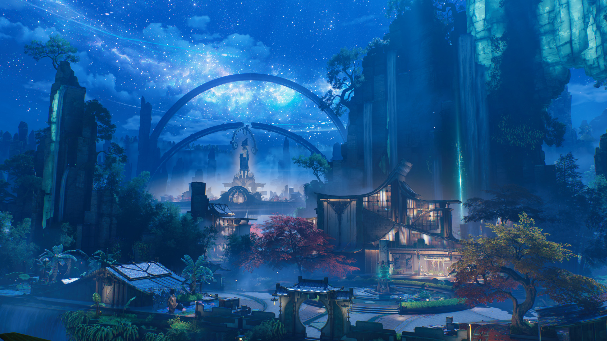
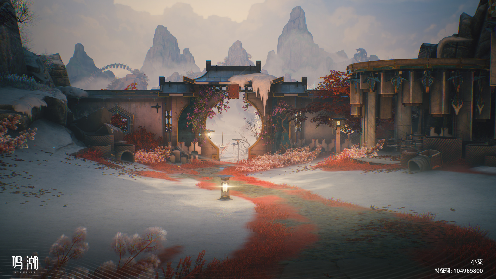

import { ArticleIntro, Comment, BookInfo } from '@blog/mdx-typo';

<ArticleIntro
  label="篇章感受"
  aside={
    <BookInfo
      label="这次玩的是"
      title="鸣潮·玄方篇"
      author={{
        name: '库洛游戏',
        href: 'https://www.kurogames.com/',
        role: '开发',
      }}
      link={{
        context: '游戏官网',
        href: 'https://mc.kurogames.com/',
      }}
    />
  }
>
  {props.post.description}
</ArticleIntro>

# 先说说我喜欢的地方

玄方城，单看这个名字，我总会想到一个“黑色的方块”，最早的先导 PV 里它也确实像一枚不断变形的黑色鲁班锁。《鸣潮》用梦州岁主「心月狐」的技术与「文明之匣」，搭出了一座机关重重的巨型城市。美术、地图、机关玩法，还有街头巷尾那些琐碎的生活，我都挺喜欢，有些地方甚至比拉海洛还要喜欢。

最直观的当然是美术。四时苑里，拨动机关就能让庭院在四季间流转；玄元境里，云梭沿着光路穿过云海；到了梦枢天罗，沉、烬、凄、怡四座心域又各有各的气质，再加上后面清幽的相心域，我尤其喜欢。

更让我惊喜的是，这三个版本能明显看出库洛在游戏工业化管线上的日臻成熟。在玄方版本，不管是场景建模的复杂度，还是材质与光影的细节，都往上迈了一大步。夜幕下的玄方城，山谷间流动的体积雾、远处山崖如玉石般的冷冽折光，和近处木格窗棂透出的暖黄灯火交织在一起，层次感极其丰富；走进相心域，屋檐下垂落的厚重冰凌、石墙斑驳的肌理、积雪下透出的一抹红草，再到远景如水墨画般晕染开的群峰，既有写实的材质质感，又把中式古典写意的留白融进了场景里。配合昼夜与天气流转，逛着逛着就想停下来截张图。再加上高密度的实机演出、部分一镜到底的过场、水墨二维与三维的无缝切换，以及依然稳定的角色 EP，单论视听规格与产能转化率，玄方篇在目前的二游里绝对是第一梯队的水准。

地图里的机关与空间设计也很好玩。以活字机关为核心的走格子、空间变形，需要动点脑子，又没有难到让我抓耳挠腮，算是我目前在《鸣潮》里玩得最舒服的一套大世界小游戏。到了梦枢天罗，地图本身更是直接变成了心月狐记忆与内心的投射——走过四角吊桥却绕回地图另一侧、看似封闭的石墙在眼前自动拼接成新通路，用这种违反现实常理的循环与重组来表现梦境记忆的不稳定，把空间探索和叙事氛围结合得很妙。
还有丹瑾的《危构悬天问丹心》，玩家能接入巨型机傀重墟的控制，砸柱子、搭通路，与丹瑾相互配合着前进。大机器人的惯性稍微有点迟钝，但亲自操纵它开路的感觉确实不错。一条支线愿意花这样的工夫设计流程，我是很受用的。后面漂泊者进入重墟枢芯内部的演出，也做得很有意思。

3.7 的几类小解谜副本，我也挺喜欢。梦构狐像、梦构心傀、梦构玉桩，通过心钥井进去，调整灯笼、停住移动的机关，或者让玉树长出新的道路，各有各的玩法。我看到的评价有些分歧，有人嫌绕，有人嫌流程长，对我来说难度倒是刚刚好。进去时摸不着头脑，琢磨一会儿又能自己解开，就这么一点“原来如此”的成就感，我玩得还挺开心。
主线和世界观叙事的结合，这次也让我觉得顺了不少。我在[一些遗憾](../鸣潮_拉海洛/index.mdx#一些遗憾)这一节里说过，3.3 上半《昨夜群星》里的全民动员其实做了很多细节，但主线催得太紧，第一次玩时我急着收集符文，错过了不少散在各处的内容。3.5 的《玄翎振壑定澜音》则借着修复通讯节点这段流程，带着玩家在城里走，自然地把备战中的生活摆在了眼前。军士在调度物资，家属围在军策府门口打听消息，商贩担心封城太久，手里的货都要烂了。拐进街角，几个混混正在发愁这日子怎么过，小弟却掏出一副从黎那汐塔淘来的牌，劝大哥先打两把「荣耀之丘」，看到这里我是真没绷住。等到总攻前夕，行人开始小跑撤离，卫兵沿街呼喊疏散，天空还给你整得黑漆漆的，气氛十足。
风波之后，机关城又有另一种幽默感。巡卫检查出城物品，按规定不许带走管制钢材，路人还在委屈地辩解：“但是这只是一个平底锅啊……”「渊中鲜」的小厨娘鲙娘，手下三口名叫文、武、爆的机傀锅各有脾气，客人挑刺，锅也会跟着不高兴，她还得赶紧招呼它们控制火候。再往野外走，看门的机械小狗会趁人走远偷偷吐水玩，等你靠近又摆出认真站岗的样子。河里还有喜欢唱歌的河狸，偶尔还会碰到几个因为唱得不好被排挤的小家伙，我第一次看到都给逗笑了。到了 3.7 筹备朝月会时，游戏还特意让漂泊者变成一只小狐狸穿过街道，暂时放下“救世主”的架子，顺着当年心月狐看人间的视角，看街坊邻里忙着挂花灯、聊家常。这种视角上的小巧思，确实让人很直观地体会到了岁主珍视的这片人间。

上面这些地方，无论是大世界的箱庭设计、工业管线撑起的视听质感，还是街头巷尾鲜活的生态细节，我都玩得非常尽兴，制作组在“怎么把一座城做活”这件事上比拉海洛还要熟练。
也正因为底座搭得这么扎实，当剧情部分没能撑起同样的厚重感时，我的落差感也格外明显。平心而论，我完全理解玄方篇在叙事上面临的难度，拉海洛聚焦的是学院、科考站与个人的存在主义困境，舞台相对纯粹，情绪很容易收束在几个人身上；而玄方要写的是“家国天下”与“两百年守城史”。要在仅仅三个版本的篇幅里，一边照顾多名新角色的塑造，一边讲述一场横跨两百年的战争与一座巨城的兴衰，这难度确实有点高。

可即便考虑了题材本身的难度，主线在具体执行中还是有不少段落让我越玩越焦躁。明明还惦记着接下来会发生什么，却总觉得眼前这段怎么还没讲完。

# 我在等故事往下走

我自己在看故事的时候，只要能占住下面这几样里的两三样，基本就能看进去：主角与伙伴们的关系进展、主角自身的成长与变化、世界观的解密、剧情结构本身的悬疑与伏笔、情感上的共鸣，以及直观的画面表现力。
怎么在长线叙事里调配这些要素、管理读者在每个阶段的期待，直接决定了我们看故事时的主观体验。比如江南的《龙族》，早期的情感共鸣与世界观悬念都很抓人，可到了中后期，当主角的成长长期停滞、人物关系也迟迟没有实质推进时，读者的不满就会迅速累积；又比如看《三国演义》，等到五丈原之后蜀汉的老将们凋零殆尽，哪怕历史的车轮还在往前滚，许多读者熟悉的情感支点与悬念已经散了，后面的章节读起来就难免有种“垃圾时间”的怅然。长篇连载是这样，单章剧情的节奏排布其实也是一个道理。

如果拿这个标准去回看 3.1 主线《远航星》，就会发现它之所以备受好评，不光是因为成本投入大、角色讨喜或者校园题材贴近现代，更因为在剧本结构上，它同时接住了上述所有期待。辛吉勒姆的“回家”，最后牵出了漂泊者的来历、被拒绝的返乡愿望，以及爱弥斯为什么一直想把真相藏起来。这些事揭开以后，漂泊者还得回答，知道这些的自己，要怎样看待正在做的事？它同时改变了我对两个角色的理解，也把眼前的冲突往前推了一步，世界观的解密直接关联着眼前的空间站危机……
可一旦剧情的安排和玩家的期待对不上，原本想往下看的兴致，就容易变成“怎么还没讲到我想看的地方”的不耐烦。玄方主线里，我好几次都有这种感觉。

## 在衔翎村停得太久

3.5 的《山雨欲来风满楼》，就让我有这种感觉。告别星炬学院之后，漂泊者回到今州，结果就碰到了炽霞重伤昏迷，秧秧失踪的紧急情况。紧接着，漂泊者与穗穗进入玄方，又在浓雾与机傀的袭击中失散。到了这里，我最想知道的事情很简单：秧秧到底怎么了？她现在在哪里？玄方城发生了什么？
随后，漂泊者遇到椋羽，得知秧秧曾经帮助她们护送村民，后来为了掩护大家而与队伍失散。既然找不到人，就借巡霄环追踪她留下的频率，视角也随之切到秧秧此前的经历。开头先安排了一场战斗，秧秧引开机傀、险些超频，被定玄卫救下，之后在衔翎村的旧屋里醒来。到这里我觉得都没有什么问题，紧张的气氛贯穿始终，我想着，接下来就应该是秧秧和大家一起去调查发生了什么吧？
可接下来剧情居然就在村子这里停住了，调查与找人的进展慢了下来，乡里乡亲的家长里短、地方传统和战前谈心纷至沓来。我在旧屋里先读了椋羽小时候的日记，从学柳琴还是学武术，到考进军策府以后去梦州还是留下照顾爷爷，先了解了一遍她的成长经历；出门跟椋羽打完招呼，开始在村子里跟村支书一样挨家挨户通知集合；路上遇到高云老伯，又听了一段玄翎雀如何传递心意、为什么灭绝、梁鸢是怎么造出来的地方志百科；接着听说孩子青彦不见了，找人途中还要听定玄卫介绍地界里的战况，以及椋羽失去两位战友后的心情；然后跟着梁鸢清掉挡路的箱子，找到孩子，再一路跟到祠堂，听他喊“我要给二姐报仇”；秧秧又感应到一段过去的影像，老村长钱坤接着介绍无名之剑与云渊之役，讲完这柄剑的来历，秧秧再像教导主任一样，给孩子上了一堂思想品德课：“我问你，你习过武吗？那么，你的另一位姐姐呢，你不打算保护她吗？”；教育完孩子，村长又托她把剑交给定玄卫保管；等拿完剑出来，还要去找椋羽做战前心理疏导，从战友牺牲聊到军人的职责，再聊到秧秧希望与漂泊者并肩的愿望，最后又说起母亲教过的小调，唱起《玄菱谣》……

村里需要喘口气，伤兵要休整，斥候还没找到回城的安全路线，秧秧自己也是刚从昏迷中醒过来，旧剑与歌谣也确实为后面做了铺垫……凡此种种，我都能理解。可我此刻还在等秧秧失踪的下文，村里却已经安排了这么多需要停下来听、停下来理解甚至停下来感动的内容。*它们真的都需要在此时此刻讲到如此分量吗？*
尤其青彦、钱坤、椋羽这几段，车轱辘话来回转，全在聊牺牲、聊活着的人怎么扛起责任，气氛一个赛一个沉重。刚劝完失去姐姐的孩子，又要开解失去战友的军人。前一段的情绪还没过去，后一段又要求我重新投入。等到机傀逼近的消息传来，秧秧终于准备出去探路，我感受到的不是危机来临，而是*我的天，这里终于要结束了*。我个人觉得青彦、旧剑和椋羽的谈话可以串得更紧，地方旧故、传统、椋羽的成长经历等内容可以分散到后面的探索里，完全没有必要趁着这一次回溯全部讲完。

## 怎么又要从头说起？

村里这一长段带来的焦躁感，在后面三条视角的切换中还会反复出现。多线叙事好看的地方，往往在于线索互补，A 视角留下的谜团，在 B 视角得到解答；不同人物的经历拼到一起，真相才慢慢完整；或者几条战线的危机相互咬合，让我们替不同的人着急。即使玩家已经知道、角色还不知道，也可以制造紧张，关键是再次经过这些事情时，尽量不要让玩家重复体验已经知道的信息。
比如《巫师3》的开场 CG [《The Trail》](https://www.bilibili.com/video/BV1cs411X7kG/?p=2)，叶奈法的遭遇与杰洛特事后的追踪交叉呈现。一边看叶奈法怎样脱险，一边看杰洛特怎样辨认留下的痕迹。我已经知道部分经过，仍然会想看他能判断出多少、什么时候才能追上。

可在 3.5 里，这些切换首先带给我的就是重复感。漂泊者先听椋羽讲机傀叛变、后玄三骑只剩她一人、岁主与梦州迟迟没有回应；切到秧秧的回溯，这些背景又在椋羽和定玄卫的谈话中再来一遍。悬天构是机傀工厂、残象销毁炉，木禺已经向秧秧介绍过，回到漂泊者这边，椋羽又得解释一次。然后我们再沿着秧秧留下的残骸、伤势和车辙，一路追到悬天构。这些过程中确实补充了人物关系，也有阿布发现机傀核心里藏着负面情绪这样的新线索，可相当一部分时间，我还是只在等角色追上我已经知道的事，这段追踪剧情本身的趣味撑不起这段篇幅。角色确实需要互相通报情况，但屏幕前的我，可是一直都在啊。
好不容易找到秧秧，三人终于汇合，穗穗又来一句“那么，就从我和漂泊者失散那时开始说起吧”，画面再倒回她那边，让玩家去雾隐阁找面具、转沙漏、救守卫，补上一套独立的密室解题。这段交代了她与心的交易、宿镜的来历，也写出了她连幻影中的人都不愿放弃的性格。可这些新内容安排在会合之后，玩家刚走到几条线交汇的地方，又要退回去，把另一条线从头补齐。
结构看着挺复杂，玩起来却总让我觉得，为啥刚往前走，又要回头补课了？

## 没紧张起来的守城战

到了玄方城守卫战，更大的落差来自玩法方面。前面城中备战的气氛做得那么好，真正开打时，城头打靶的抢滩登陆小游戏却占去了非常显眼的一段流程。冲过来的残象大多是大世界里熟悉的杂兵，在蹩脚的视角和毫无打击感的玩法下，旁边的 NPC 又不断地吹着我的彩虹屁。我在这里实在没有多少防线会被突破的紧张感，只有说不出的尴尬……

我玩过的单机 RPG 不算很多，这里我想举的例子是《巫师3》的[凯尔·莫罕之战](https://www.bilibili.com/video/BV1yT411R75q/)。这场战斗是怎么做的？战前杰洛特和伙伴们一起筹备防务，谁维持屏障、谁提供火力支援、谁去城外关闭传送门，主要分工先交代清楚。开战之后，杰洛特和兰伯特在森林里行动，到处寻找落单的敌人和传送门，发出信号却等不到支援；视角切到希里，原来是特莉丝被敌人围住了，帮特莉丝解了围，火球才终于落下来。随后敌人越来越多，只能退守，又是骑马撤回城堡、登上城墙关闭大门、继续向内庭撤退，希里还得去支援艾斯卡尔，打开门接应大家。从城外森林到城墙，再到庭院，玩家眼瞅着战线一点点往里收紧。玩家在两个角色之间切换，一处出了问题，另一处就得赶紧补上；眼前的任务不断变化，能守住的地方却越来越少。这里并没有做同屏人海，只把“防线一步步失守、伙伴们在各个节点苦撑、玩家跟着战局来回救火”的层次感做出来，就已经能让玩家体会到围城战带来的压抑和紧张了。

## 下一章又要重新投入

放到三个版本的整体安排上，我的感觉也相近。3.5 是机傀暴乱与全城守卫战，3.6 进入玄元境追捕木禺，最后还要挡住残响侵蚀造成的天崩，继续救城。3.7 又进一步揭开心与溯心的权限争夺。战场从城外走进神宫，危险并没有因此缩小，但我的关注对象却换了几轮。
心的困境一直有铺垫。3.5 的穗穗已经察觉她有难言之隐，3.6 有不同于木禺手法的机关停摆，有她托付清宵的约定，结尾也留下了某处园林无故崩毁的悬念。寻找岁主也始终贯穿其中。只是木禺之乱结束、玄方城恢复运转的那一刻，对大部分玩家来说，玄方城保卫战已经告一段落，剩下的问题无非就是心月狐到哪儿去了？但是 3.7 进来就是说玄方城要崩塌了？我这情绪完全没接上，甚至觉得有点烦，怎么又来？

所以通关后，我也忍不住做了点马后炮式的设想。保留 3.5 的调查与局部战斗，把大规模围城后置；3.6 木禺败亡时鱼死网破，直接使溯心取得优势，导致城内机关大面积失控；3.7 让清宵、秧秧和军民守在外面，漂泊者与锁暝进去帮助心夺回控制。原作没有这条直接触发的因果关系，这样调整的话，就能把每个章节的矛盾串起来，推着剧情往后走。
我还有个想法，像《明日方舟》的 Side Story 那样，用独立篇章直接讲玄方城如何建立。让玩家跟着当事人一路经历过去的选择，也能少些在今天与往事之间来回补课的停顿。

在玄方，主线花了不少工夫带我们回顾当年发生过什么，世界观确实是在一点点解密，但我想往下看的劲头没有跟着增加，偶尔甚至觉得自己在“参观历史博物馆”。不过，光用节奏慢还解释不了所有差别。同样是聊过去、聊心事，有些对话让我愿意一直听，另一些却让我越来越不耐烦。

# 说来说去，还是这些心事

## 我已经听得足够明白了

我在拉海洛篇的[演出与文本](../鸣潮_拉海洛/index.mdx#演出与文本：克制化的表达)里，夸过拉海洛的台词和演出。有些话没有说透，但看着人物的反应，我能明白她想说什么，又在逃避什么。到了玄方，剧本却总是急着把这些说透。前面的经历和对话已经让我理解了，后面还要带着我反复确认，甚至连她怎样理解自己，也要有人替她整理得明明白白。说得难听点，玩到半路，我常常只想问一句：*我已经知道了，能不能别再替我总结了？*

最明显的就是心，朝月会还没办起来，她先担心民众见到自己的模样会失望；好不容易点亮月灯，又说自己理应回应人们的期待，“可我……连这一点，都做得如此艰难”；等灯会办起来，面对自己勉强收回的一缕友人残息，她又觉得“若是祂，想必会做得更好些吧”；看完前代遇刺的记忆，她感慨“或许我便是缺了岁主的魄力，才导致了如今的局面”，接着又问“御者，这算是一种欺骗吗？”，漂泊者便告诉她，“一直以来守护玄方城的人是你”；接着往建城的回忆里走，她救下一个保护孩子的人，鼓励他加入定玄卫，对方和他的后代也真的成为了英勇的军人，她却又担心自己“无法保证能够实现他们的期许”，漂泊者再开导她，“没有人的未来需要由别人来做保证”；再走一段，看到工匠们改进机关、加快建城，她担心这些人会更早化为天人、被永远束缚在城里，便让他们暂时放下工作，去看看自己建造的城市，希望城里也能留下他们生活的足迹，可说到最后，又要问一句“会这么想，我到底是更像心月狐了还是更不像祂了呢？”，漂泊者只好再接一句“心……你是你自己”；等战争的回忆结束，谈起那些最终只在石碑上留下名字的牺牲者，漂泊者又说“心，你已经做得很好了，他们也一定知道你已经尽了全力，只是……”，心接过那句“只是情势所迫，我知道”，随后继续讲自己能做到的事情实在不多，兜兜转转，还是当年那只小狐狸…… *这还没到心湖桥呢。*
结果真到了心湖桥，漂泊者开口又是“心，你已经做得很好了，我不在的时候，辛苦你了”。心终于承受不住，喊出“不要再说那种温柔的话了……我……我……”，继而坦白“岁主已经死了！”“我知道……祂离开了……是我害死了祂。”她准备牺牲自己，换回前代，漂泊者再点破她借御者之名逃避的打算。她终于把压在心底的秘密说出来了，我却早在前面一轮轮的自疑与宽慰里听得麻木了，这一路上，我到底还要听多少遍她做得不够好，再听多少遍别人告诉她，她已经做得很好了？

秧秧这边，让我烦躁的主要是那几轮道歉和宽慰。到了悬天构，好不容易重逢，她先说“抱歉，我没能拦住他……”，漂泊者纠正为“「我们」没能拦住他”；聊过炽霞的伤势，两人开了几句玩笑，她又说“对不起，漂泊者，让你担心了”，漂泊者回她“可别再弄丢咯？”；转头见到椋羽，又是“对不起，椋羽，我没能——”，椋羽赶紧打断，“别说了，秧秧。朝谁都可以，但不要朝我道歉”。我当时在屏幕前猛猛点头。椋羽！你做得好啊！结果我高兴得还是太早了——走在回城路上，听说漂泊者收到信就赶了回来，她又开始“这么说，我又把你拉进麻烦里来了……”，漂泊者再告诉她，“确认你平安无事，才是最重要的”；等守城战结束，联系今州报平安，白芷刚说看到两人平安无恙就足够了，她又道歉“……对不起，我害大家担心了”，相里要再宽慰“不必自责”……
除了连轴转的道歉，她劝起人来也总带着股解说员的味儿。衔翎村里，还没找椋羽谈心，颜朗就已经介绍过，她把牺牲的两位同伴视如兄姐，又因为“领兵之人，不可在将士面前露怯”，只能把心绪咽进肚里；等找到椋羽，她自己说“……我害怕对上他们的视线”，讲大家期待有人挺身而出，讲同伴本来更能担当，却偏偏是他们死了、自己活了下来。然后秧秧已经替椋羽把心理活动总结好了，“你很清楚自己应该怎么做”，“只是害怕做得不够好，只是因为有些事没有试错的成本”。椋羽都已经说得这么明白了，还要替她点明到这一步吗？
铃坊那段，这种总结就更明显了。铃坊舍不得扔掉丈夫亲手做的箫，还记得他笨手笨脚，这支箫根本吹不出声音；说起参军，她又直截了当地告诉我们，“没什么冠冕堂皇的理由，残象杀了我的爱人，我用剑为他报仇，就这么简单”。后来提起父亲，她也承认，自己到现在都不太理解那些为国为民的思想。这个人说话有自己的脾气，牵挂也很具体，我已经愿意听她再多说一点了。秧秧却马上接过话，把它又替她拔高到了统一的主题上，“人会因为「珍视的事物」悲伤、高兴、恐惧、羞耻，乃至愤怒”，再点明“所以，人们才会去「守护」”，接着解释她守护的不只是两个人的回忆，还有未来更多情感将要诞生的地方。人家铃坊刚实实在在地说完自己没什么大道理，秧秧倒好，反手就把顶高帽子又给人端端正正扣回去了。

连我很喜欢的丹瑾支线《危构悬天问丹心》，也有这个毛病。重墟与万囮牢共用一个意识，为了避免失控伤人，才引我们来消灭自己。丹瑾看着这些怀有善意、却可能不受控制地伤人的机傀，会想到什么，并不难理解。漂泊者进入重墟的枢芯，与丹瑾一起帮它活了下来。她仍认为，发现自己可能作恶就斩断生路，是最正确的选择；漂泊者提醒她，这一次有人帮了它。回到池边，她记得锦鲤叫“群彩”，也惦记着素玙的照顾，想在分别前给她准备惊喜。
偏偏接下来的谈话，还要替我把这个人介绍一遍。漂泊者先解释素玙的担心，提到她心里是否只装得下“战斗”与“复仇”，是否只想给自己找到一副枷锁，接着又把丹瑾的性格逐项说了出来：“你是会为帮助他人拔刀、为牺牲者难过，又会在意锦鲤名字、爱吃龙须酥的人，不是吗？”一起经历了这么多，我当然知道她是什么样的人，不需要你再来复述一遍！
后日谈里，她真的拿着自己做的龙须酥来请人试吃，甜得过头，两人又商量下次怎么改。从救下重墟，到自己试着做点心，这倒是挺不错的。

关于台词怎么做到不说满，我在拉海洛篇的[文本的减法](../鸣潮_拉海洛/index.mdx#文本的减法)里也已经聊过了。这里只拿《在熔解的夜空下》电话亭那段作个对照。达妮娅明明不想让西格莉卡担心，嘴上又要补一句，有这样一个信赖自己的朋友，身份才不容易暴露。漂泊者说“自欺欺人”，她回“……我还以为你会说得委婉点”，然后两人就回去了。她在乎谁，又在给自己找什么借口，我已经听明白了；被揭穿后还要回敬一句的脾气，到这里就够了。要是照玄方这几段的写法，这里高低得给你接一段：“其实你早就把她当朋友了”，然后达妮娅再回应，漂泊者再总结的流程。

## 工具化的反派

这种凡事都要说破、替人总结的习惯，一旦落到反派身上，就会让对手戏变得非常单薄。

单看设定，3.6《烟云幽远心剑鸣》里的木禺其实是很有潜力的。他是从云渊之役活下来的凡人，琢钧堂出身，在战场上见识了人力的极限，便走上了抛弃情感、靠技术改造生命的狂热道路：“你们笃信脆弱的情感和意志，却不懂得人只有靠先进的技术才能掌握自己的命运。”他把亡者的残响当耗材，想要褪去凡胎，“成为完美的天人”。而他的对手清宵，恰好和他反过来。师父教她“远离人世，明心静气，便可忘情”，要她摒弃俗欲、斩却心魔，她却偏偏“看到他人不幸就会难受，撞见残象伤人就心里冒火”。一个把情感当缺陷、想升格为天人的凡人，对上一个被奉为剑仙、却始终放不下凡人悲欢的修行者，这个对照本身挺有意思。
到了决战，两边在交手逻辑上也扣得很紧。木禺弃置肉身，将意识附在天傀上，想靠抽取地境亡者的残响继续战斗；清宵此前给那些实验品机傀分出的剑意，恰好在这时阻断了他的汲取。他拿亡者当实验材料，可惜最后也栽在了这里。
可为什么这么工整的一组正反对照，实际打完却让我觉得差了一口气？我个人认为，木禺这个角色在剧本里太像一个专程赶来给清宵“证道”的工具了。3.5 里，他先以天工匠人的身份给秧秧当了一路渊城历史的解说员，到了咎庭决战，又拿情感危险、终须舍弃的说法，和秧秧辩过了一轮。
到了 3.6，进入内景之前，他先拿外面的战况逼清宵，问她“你能救这些人一时，还能庇护他们一辈子？”随后，内景中的心魔翻出云渊之役救不下所有人的惨剧，质问她“当初你何必出手？你何必自毁心境，徒增伤悲？”清宵接纳心魔的力量，亲口承认“我本就不是仙人，也不必在乎什么大道”。结果走出内景、来到天境，木禺又开始讥讽“本如仙人的你”，却被“无用的情感、渺小的凡人绊住了”，清宵再回答“因为，我在乎”。她在内景里已经给出了答案，木禺却还要在外面拿同一套题再考她一次。最后，他在后日谈《幽客销残声》里被寻幽客景燃追上了结，景燃为那笔旧账报了仇，也回敬了他一句“都不做人了，算个哪门子完美”。

到了 3.7《梦枢心相由心生》中的最终 Boss 天演溯心，这种“复读心事”的感觉就更强了。它和 3.1 的辛吉勒姆，都是把某种执念或规则变成眼前的敌人，但辛吉勒姆的作用要扎实得多。它越是执着地念着“回家”，爱弥斯就越要阻止它接近漂泊者、说出真相。随着追逐和交锋，漂泊者的来历、被拒绝的返乡愿望，以及爱弥斯一直隐瞒这些事的原因，才逐渐揭露出来。漂泊者向她表明态度：“无论真相是什么，都该由我自己来面对，自己来选择。”她想替他挡住痛苦，却也替他做了决定。辛吉勒姆的步步紧逼，把两个人的分歧推到了眼前，也逼着漂泊者直面自己的身份。
再看天演溯心，前面明明铺垫了文明之匣的销毁逻辑、权限争夺与覆写人格的代价，心一路修复心域也是在夺回控制权。平心而论，这场最终战在视觉演出上绝对拿出了终章该有的排面——锁暝用玄朱锁救下心、让她在锁内与前代心月狐留下的回响跨时空对话，随后天演溯心化作遮天蔽日的巨型心月狐形态压满视野，山体、机关乃至整座玄方城都被卷入两股力量的正面冲撞，单看场面调度和音乐烘托确实足够震撼。可一旦细听他们交锋时的台词，溯心先说“违背规则。逆反逻辑。低效。冗余”，接着又喊“你不配为「岁主」！”这不就是心自己念叨了一整章的自我怀疑吗？而心回应它的，也依然是对人类情感的又一次肯定：“这便是人，这便是情，这便是心，这便是——文明。”违背规则之后会走向何处，到了这里，也只落成溯心一句“前路也混沌莫测”，和心一句“那这前路，就由我们一起去吧”。心接着宣布要阻止城市崩落、把濒临消散的天人收入宿镜，最后溯心却又给了她一句“凡有心者，当是如此”，紧接着心月狐再确认“心，你果真能成为独一无二的「岁主」”。前面铺垫了半天的规则和代价，真打起来了反而轻飘飘揭过去了，倒是她配不配做岁主这事，一直确认到了敌人点头……

从 3.6 的心魔、木禺，到 3.7 的天演溯心，玄方篇一连串的对手戏看下来，敌人嘴里说出的话，往往就是主角心里早就想过的话。怎么打到最后，大家还在确认同一件事？

# 仁政田园诗

## 木禺的反问

我在写这篇文章的时候，回顾整段剧情，发现了一个之前被我忽略掉的点，就是木禺在玄元境现身时，其实提过一个很尖锐的问题。他拿出那些没有在云渊之役中投入使用的技术蓝图，质问岁主当年的选择：“玄方城本就有机会逆转云渊之役的大局。猜猜看，我们的岁主心月狐，当时是因为不能……还是不想？”漂泊者回答：“你可以猜疑岁主的动机，但你的堕落，与岁主毫无关联。”这话反驳了木禺，却没有回答他的疑问，这次交锋也就停在了这里。木禺明明问到过岁主的决断，到了和清宵交锋时，却又主要围着她已经回答过的心事打转。
到了 3.6 末尾，清宵重新问起玄元境中的那座城，心才给出了解释，那些设计确实存在，只是“时间来不及”。3.7 又补上了当时的处境，文明之匣受损，心只能从归字枢的原型开始，一点点建起玄方城，鸣式的袭击却在工程完成前就到了。为什么没赶上，剧情交代得逐渐清楚了。

心当时还给过另一个理由：“超前的机关术对梦州文明而言本就祸福难料，是不可授予人世之物，它牵扯且改变了太多人的命运。”这句话让我反应过来，岁主既是守护者，也是实实在在的统治者。到了 3.7 的建城会议，这副统治者的面孔终于被摆到了明面上。

## 建城会议里的政治家

会上，心月狐明说“建城者，有去无回”，稷廷与琢钧堂仍然争着承建，各自陈述技术、经验和安置民众的优势。心月狐说，她需要对技术更自信、更纯粹的人，于是选择了稷廷。可等双方离开，州监一问，我们才知道，她事先就已经有了决定。这场会议还承担着安定人心、最后确认隐患的作用。而她认为“更危险”的，恰好就是刚刚选中的稷廷。
他们愿意为了真理毁灭自身，也会想尽办法让技术留下来。在心月狐看来，脆弱的文明却承载不了这些过于超前的知识。前面还在被赞许的求知欲，转眼又成了需要防范的东西。“朝闻道，夕死可矣”，工匠说出来时是慷慨的，到了心月狐嘴里，却接上了一句“那就满足他们的‘遗愿’吧”。甚至你邪恶一点地想，这个画面像不像是工匠们在前面慷慨赴死，上位者在背后顺水推舟把隐患一块儿埋了？这段剧情的气氛一下子就有了点权谋的冷峻感。

在这场会议里的心月狐，和之前几位留给我的印象都有些不同。角掌握时序、预见命运，也像一位严厉的亲长，今汐要向祂证明自己的选择，才能接过守护今州的权柄。英白拉多曾以神明的意志引导文明，后来又开始反省，自己是否有权决定人们的命运，最终把未来交还给人类。拉海洛的隧者则是一个沉默的守护者，它取出炉芯庇护冰原上的人，后来又装上人类为它制造的心脏，继续为他们守住隧门。
而坐在建城会议上的心月狐，更像一个成熟的政治家。哪一方更可用，哪一方更危险，什么话该在会上说，什么话只留给州监，她心里都有数。连这场会议本身，也有选定承建者之外的用处，要让军民知道边庭已经有所决断，安定人心。她对这片土地的守护，在这里有了很具体的治理手段，也带着一种经历世事之后的老练。几句交谈，就让岁主和下面这些组织之间的关系变得微妙了起来。

2.7 下半的《独在异乡为异客》，也有这么一段。仇远身为明庭重犯，却接受着军策府的秘密委托；芬莱克想保护拉古那，也不容任何人把城市“从我手中夺去”。他们各自有要守护的东西，也各自背着旧账。仇远与芬莱克谈的是眼前的合作，话里却始终带着身后的政治斗争和上位者的野心，以及尚未了结的是非。
我喜欢那场对话，还因为他们之间的合作，没有把此前的争执一并化解掉。芬莱克可以说自己宵衣旰食，仇远也照样可以说他“经文上满是仁义道德，自己却恶贯满盈”。两个人把接下来的事情谈妥了，芬莱克的功过仍然留在那里，最后落下一句“史笔如铁，自有后人评断”。
这种政治武侠剧的味道，在《独在异乡为异客》里很浓。到了 3.7，则主要集中在建城会议，以及结尾筹划梦州之行的两处。前面是岁主与各方势力的权衡，后面是明庭与谛天鉴的暗流，几个人各自带着一笔旧账，准备结伴上路。尤其是建城会议，它已经把岁主怎样作出决定的过程摆到了眼前。

神明在上面画了一条红线，底下的凡人却得在这条线里挣命、求道，甚至把命搭进去。这里已经有了很具体的冲突。沿着这个线再往下写，心月狐定下的规则，也就成了心和工匠们每天都要面对的生活。

## 怎么又说回了她自己？

后面的回忆中，有一段我很喜欢。工匠们改进活字机关，提高建城效率，心由此认识到，玄方城也凝聚着他们自己的智慧和创造。可建得越快，等待他们的永久束缚也就来得越早。于是她让他们暂时离开工坊，去看看自己造出的城市，希望他们能留下生活的足迹，拥有求索和牺牲之外的快乐。工匠后来也向她道谢，说朝月会比想象中还美。写到这里，工匠终于从愿意献身的建城者，变成了可以在城里过节、可以有自己感受的人。
可这段谈话聊着聊着，重心又落到了心身上。她问，自己到底是更像心月狐了，还是更不像了。漂泊者回答：“心……你是你自己。”让工匠走出工坊，本来已经打开了一个很好的话题，造出这座城的人，能不能也拥有城里的生活？这次破例对他们意味着什么？剧情刚往这里走了几步，就又回到了心怎样认识自己。我看到这里都给气笑了，怎么我才刚想多看看工匠们的日子，剧情就又忙着帮心做心理建设了？
到了心湖桥，心直接问起，自己做的这些事，是不是梦州民众所希望的。漂泊者的回答也很清楚，修复文明之匣、建立玄方城的是非功过，他无法替玄方民众下论断。接下来，他说，自己从民众口中听到的，对“心月狐大人”的期盼，绝非虚假。是非功过暂且放下，谈话先落在了民众仍然需要她、期盼她这一点上，漂泊者的回答再次绕过了最核心的问题。
随着剧情进入高潮，心重塑文明之匣，阻止城市崩落，也安排保存力竭的天人。再到最终战里，溯心先质问她“你不配为岁主”，原来的心月狐又在最后告诉她，“心，你果真能成为独一无二的岁主”。前面关于技术、规则、牺牲和守护的不同问题，到这里，这些情感释放都汇入了对她的认可。

这也是我玩得焦躁的原因，建城的人该怎么活？岁主凭什么决定哪些技术可以传给人间？这些本来挺有意思的剧情钩子，不管是从哪个话题聊起来，聊着聊着指不定就要拐回“心好善良、心好不容易、心值得被肯定”的老路上。我知道她很善良了！每次新矛盾一出来，我满心以为终于要深挖下剧情矛盾了，结果它转头又拿这事儿去给心做心理按摩。故事表面上是在往前走，可核心问题一直在原地踏步。

## 守护者和她守护的地方

说到这里，我也想起网上关于玄方有没有写出“家国天下”的争论。我觉得，围绕几位主要人物，讲一个温暖的守护者的故事，这种风格本身没有什么问题。岁主爱着这片土地，民众也愿意相信她，最后大家一起迎来朝月会的灯火，这样的*仁政田园诗*，本来就有它动人的地方。考虑到二游对角色塑造的依赖，我也能理解为什么剧情会把这么多篇幅放在心的痛苦、善意和自我接纳上。
只是“家国天下”这个说法，承载的期待确实要大得多。除了几个人愿意为这片土地付出什么，还有无数生活在这里的人们，他们彼此有怎样的联系，他们为什么把这里当家，又怎样受到过去那些事情的影响。这座城往哪里走，由谁作主，哪些人要承担这些决定的后果，身处其中的人又怎样理解和回应，也都是故事已经碰到的问题。这些都需要叙事去铺垫。玄方三个版本里，既要推进眼前的危机，又要交代战争与建城的往事，还要完成几位主要角色的故事，能分给这些内容的空间确实有限。至于岁主遇刺的真相、明庭与谛天鉴的暗流，也已经明确留给了梦州，等后面的故事继续往下讲。

前面那些反复的自疑与宽慰，已经让我很清楚地认识了心的痛苦。但是她所守护的这座城本身，却没有得到同样充分的展开。工匠走出工坊之后怎样看待自己的选择，战后的人们怎样重新过起日子，过去的决定又怎样影响后来的人，这些事情在剧情里已经有了开头，却没有继续展开，实在是可惜。
我会因为喜欢心，想多了解她守护的地方；也会因为街头巷尾那些热闹的小事，更在意这里的人是怎么把日子过下来的。可当主线一遍遍把镜头拉回两百年前，我又忍不住开始想另一个问题，当年的牺牲与守护，跨过整整两百年落到今天，中间那漫长的岁月到底是怎么走过来的？

# 这两百年，是怎么过的？

清宵和心为什么痛苦，主线已经讲了这么多。但不管是她们，还是这座玄方城，主线在讲起过去时，绝大部分镜头都定格在*两百年*前云渊之役和建城的那一刻。虚构作品里，拉长时间只要在数字后面多敲几个零；放到现实里，两百年已经是七八代人的光阴。有些段落看下来，我甚至觉得，把承受痛苦的时间缩成二十年，或者短短几年，眼前这场倾诉似乎也能成立。这漫长的两百年，到底给她们和这座城留下了什么？

## 战争之后，人还要过日子

梦枢天罗里有一位休息的天人说，为了减轻意识的负担，天人对时间流逝没有感知，云渊之役的惨状于他就像昨天。这个设定能够解释他的停滞。可写到清宵和心时，镜头也常常回到那个“昨天”。理解了她们的痛苦之后，我还想知道，那份痛苦是怎样和漫长的日常共存的？她们后来遇到了谁，养成了什么习惯，又有过什么新的愿望？
主线里确实写过这样的痕迹。衔翎村的钱坤、高云聊起早年那场暴雨，当年被清宵救下的孩童，如今已经成为张罗巡逻、替军策府分担压力的老人。烟舒婆婆把先祖留下的旧画当作辟邪纳福之物，清宵记得的却是画中那只玄翎雀总静不下来，要啄她的头发。别人眼中的先人遗物，在她这里还是一件亲身经历的小事，这长生者和凡人的时间错位感就有了。
到了结尾，她还请漂泊者和阿布吃那道记了多年的梦州醋鲙，说起玄渺真人带着徒弟来访，让自己渐渐明白“救人一时，或是救人一世，都不如授人一式”。心也有类似的生活片段。玄翎雀日复一日地为她带来这片地界的四季，她会因为听了馊主意填错山峰，要求它拿两三件趣事补偿，又在它的提议下为自己取了名字。这些细节让我喜欢，也能看出人物有过怎样的相处。
清宵记得两百年前的漂泊者，今天又成了他的剑术师父；带着缺损记忆的心，也在和御者重新相识。记得的人与忘记的人，今天怎样重新相处，这本来就有许多可写的东西。只是相比于反复回溯云渊之役的惨烈与角色的内心自责，它们在主线里占的篇幅还是太散、太短了，完全不足以连成持续的生活印象。

## 白云和黑土的几十年

云渊之役留下的旧事，玄方街头正在过的日子，还有风波平息之后，人们各自盼着的以后。聊到这里，倒让我想起了《昨天今天明天》这个小品。十来分钟，台上三个人，讲了白云和黑土四五十年的生活。两个人的家长里短，就这样和当年的大事小事串到了一起。以前谈恋爱，送一捆秋天的菠菜也能叫暗送秋波；白云还在操心金融危机和国际局势，黑土就在旁边嫌她操心得太远；想织件毛衣，就在放羊时薅羊毛，偏偏只盯着一只羊薅，毛衣还没织完便给定了个“薅社会主义羊毛”的罪。结婚时家里穷，黑土却偏要找补，说自己还有一件家用电器，原来是手电筒。这些笑话里有人的小聪明、小窘迫，也有那个物资匮乏年代的日子。
等生活富起来，有了小楼、电视和电话，两个人又有了新的争执和念想。白云忙着学外语，夫妻俩为了看谁的节目抢遥控器；白云那两颗门牙，也是“光荣下岗”了。展望未来，她惦记着装烤瓷牙，黑土想着去铁岭度蜜月。他们还是那对爱拌嘴的夫妻，可他们争什么、想要什么，已经和年轻时不同了。

当然，小品有一个奇幻作品很难照搬的便利，提一句洪水，说一个当年的流行词，台下观众的共同记忆就能接上。奇幻世界里的历史，需要作品自己一点点建立，但也不必给两百年填满一份大事记。我觉得，玄方自己其实已经写出过很好的例子，只是更多落在了支线里。

## 菜谱、家书，还有一场告别

《失落的味道》开场，陶老把鲙娘做的菜贬了一通，念叨百多年前渊城老店的厨仙菜才是绝味。可他那时候根本还没出生，所谓天下至鲜，其实只是从父兄口中听来的传闻。鲙娘顺着先祖留下的行军日志寻找配方，才知道这道菜诞生于云渊之役。粮道不畅，物资匮乏，掌勺就地寻找能用的食材，连损坏机关中长出的韧笋也上了餐桌。
菜终于做出来，却没有想象中那么惊艳。它有鲜香，口感也并非糟糕，只是配不上陶老口中的盛名。守岸人查验后，排除了食材性质改变的可能，答案落在了这些年别的菜和食客身上。战后食材重新丰富，历代掌勺不断调整配方；渊城地势低洼、终年多雾，当时的人偏爱辛辣，如今的口味也已有变化。厨仙菜留着原来的做法，周围的饭菜和吃饭的人却一直在变。
我很喜欢这个落点。陶老相信的旧日美味，包含着后人对传闻的想象；小厨娘最后做出的怀念版，也不必和古方一模一样。遗憾是最后改良的过程稍快了些，我还想多看一点她怎么试、怎么改，食客们又是什么反应，会不会又有玄方特色说书人来感慨一番之类的。
顺着这个故事，我也想过另一种写法，拿抗美援朝时期志愿军的炒面做参照，假设原版是战时只能勉强果腹的粗粝食物，再写今天的厨师怎样把它改得适口。这样从求生到生活的差别，或许会让故事更有棱角。

在《不改旧时影》这个故事中，初岫的父亲病重，却不愿提回乡的事，他悄悄来替父亲寻找亲人。父母二十多年前因两家不和而出走，旧怨又能追到云渊之役之前。按初岫听来的说法，当年女方拒绝婚约、不知所踪，男方以为被背弃，后来上了战场，死在渊城之底，两家因此互相怪罪。但传到初岫这一代，连父母也已说不清最初究竟发生了什么。结合主线设定来看，女方多半是签了“建城者，有去无回”的保密死契，去参与玄方城建设并化作天人了。
可时间妙就妙在，它不会只让仇恨原封不动地传下去。到了初岫父母这一代，年轻人的相爱冲破了早就说不清原委的祖训，代价却是私奔和远离故土。而留守在村里的爷爷和外公，在儿女走后大吵过、冷战过，最后为了不再让老街坊看笑话、也不再把冤孽传给后人，两个倔老头居然默契地各自搬了家，却又都在废弃的老屋里悄悄留下了一封信和新地址，盼着私奔的儿女哪天能回来看看。
旧怨传到今天，年轻人用私奔冲破祖训，留在故乡的两个倔老头，也在儿女离去后慢慢松了口。一代人有一代人的活法，连固执的长辈也会变，这就特别有时间的味道。

《最后的方庭演武》的故事则是属于那些被历史抛弃的旧日造物。这个任务的前置是要通关散布在玄方地界各处的一系列方庭演武，也就是前面提到过的操作小机傀走格子的小游戏。这些场地原本是玄方城启用前的机傀试验场，如今早已蒙尘。一路玩下来，我们替机傀完成演武，也听到了来自过去的录音，最后才走到这场告别。
机卫一、机戍四和机袭三知道战斗已经结束，知道“方庭，我们，已是历史”，但指令还刻在身体里，让它们痛苦、怠惰、难过。它们希望不要再有新指令，因为那意味着危机还会继续，却又不知道自己的存在还剩什么意义。前面我们一直在帮它们完成任务，到了最后，它们提出的请求却是：“与我们并肩，用最后的战斗，结束我们的使命。”
这段对话并不长，但走过前面那些演武场，再听见它们说“愿我们永远……不需醒来……”，感觉就不一样了。它们盼着自己再也不被需要，却又只能靠最后一次战斗，为自己的存在找到一个结局。这场迟来的告别，让我觉得韵味十足。

除开这几个故事，玄方其余的支线大多落在了两头。一头是围绕眼前生活与近期战事展开的故事，比如《致富好项目》里围绕简集展开的防诈骗小品，或是《定玄之外》讲述守城战之后伤兵、还有想要加入定玄的青彦的故事；另一头，则是天人困在漫长岁月里的停滞，或是进入梦枢天罗回望过去的牺牲与执念。比如《鱼归巢》与《匣中奇谭·苍狐记》，玩家进入梦枢天罗保存的过去切片，透过望回环，看看两百年前的无衷如何把自己最后的频率留给与亡妻共同设计的机关，或是被自己的执念困住一遍遍重复那场救不下战友的突围战。
并不是说写停滞、坚守和回望不好。所谓历史本就有两面：一面是“不变的执念与守望”，另一面则是“变化的世道与人心”。让我困惑的是，两百年过去了，主线每逢讲起历史，重头戏怎么还是云渊之役、玄方建城，以及那时留下的伤痛？战争与建城当然足够重要，可城建起来之后，这里还住过一代又一代的人。这两百年前的云渊之役与玄方建城，到底在多大程度上塑造了玄方城人们今天的生活？

# 想过去，看今朝

剧本留下的遗憾很多，可把地图、玩法、演出和支线都放在一起看，玄方城仍然有不少比拉海洛更扎实、更丰满的地方。
关掉游戏之后，我还是会想起那顿酸倒牙的入门宴、小厨娘改过的菜谱，还有初岫找到的家书。随着朝月会的万家灯火重新亮起，长生者放下了执念，短生者迎来了新岁。漂泊者也将去往下一个地方，继续认识这个曾经认识他的世界。
从今州到黎那汐塔与拉海洛，再到玄方，《鸣潮》有过让我惊喜的时候，也有让我不耐烦的时候。它的地图和市井生活越做越丰富，主线的表现却有起有落，我的期待也跟着改变。我一边嫌它台词啰嗦，一边又把房间角落里的字条翻了个遍。见过它写得好时有多感人，也看到了它在别处的进步，下一站会讲出什么故事，我还是想接着看看。

想到这里，我觉得白云大妈那句话，很适合拿来收尾：

***“我是生在旧社会，长在红旗下，走在春风里，准备跨世纪，想过去，看今朝，我此起彼伏。”***
